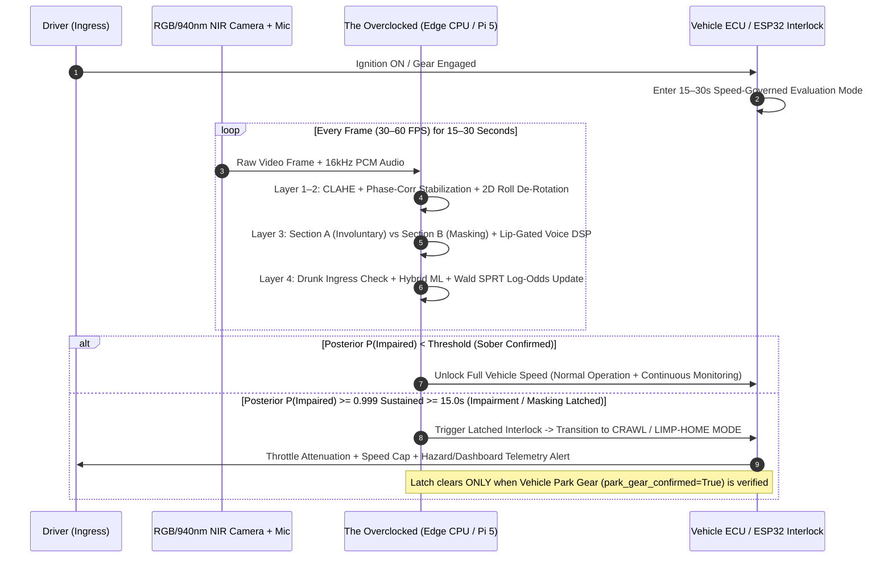
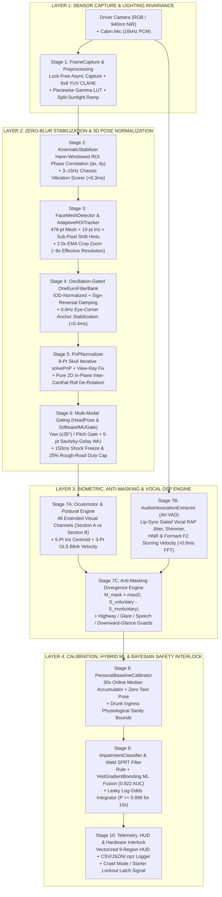

# The Overclocked: Oculomotor & Vocal Driver Monitoring System (DMS)

[](https://www.python.org/)
[-brightgreen.svg)](#verification--test-suite)
[-00b4d8.svg)](#machine-learning--multi-subject-validation)
[](#key-engineering-innovations)
[](https://opensource.org/licenses/MIT)

**The Overclocked** is a real-time, edge-optimized **Oculomotor, Postural, and Vocal Driver Monitoring System (DMS)** written in Python (OpenCV, MediaPipe Face Mesh 478-point + 10-iris topology, NumPy/SciPy DSP, and Scikit-Learn). It passively measures **strictly involuntary subcortical, brainstem, and autonomic micromotions** alongside **lip-gated vocal-tract acoustics** from a single driver-facing camera (RGB or 940nm Near-Infrared) and cabin microphone to detect alcohol intoxication and severe fatigue within a **15–30 second speed-governed ingress evaluation window**.

> **🤖 AI & Teammate Context Notice:**  
> This `README.md` serves as the **Single Source of Truth (SSOT)** for human developers and AI coding assistants (Google Antigravity, Gemini, Claude, Cursor). It documents the complete 4-layer architecture, all 55+ extracted physiological/acoustic channels, the 10-phase cabin vibration hardening pipeline, the Anti-Masking Divergence engine ($M_{\text{mask}}$), the Wald SPRT Bayesian safety filter, the TRIZ engineering matrix, and the Raspberry Pi 5 + ESP32 Hardware-in-the-Loop (HIL) deployment topology.

> **⚠️ Regulatory & Clinical Candor Disclaimer:**  
> This system is an **edge AI measurement and research framework**, not a clinically certified medical device or ISO 26262 certified production safety unit. While the ML model is cross-validated across 9,460 temporal windows (337 subjects), heuristic rule cutoffs marked `[PLACEHOLDER]` represent physiological design targets. Camera-based oculomotor tracking reliably resolves impairment from $\sim 0.05\%\text{ BAC}$ upward; catching impairment down to India's strict $0.03\%\text{ BAC}$ legal limit requires secondary multi-modal corroboration (vocal dysarthria + smart seatbelt/breath sensors).

---

## Table of Contents
1. [Operational Concept: 15–30s Speed-Governed Window & Crawl Mode](#1-operational-concept-1530s-speed-governed-window--crawl-mode)
2. [System Architecture & 10-Stage Execution Pipeline](#2-system-architecture--10-stage-execution-pipeline)
3. [4-Layer Subsystem Deep Dive & Module Map](#3-4-layer-subsystem-deep-dive--module-map)
4. [10-Phase Cabin Vibration & Real-World Automotive Hardening](#4-10-phase-cabin-vibration--real-world-automotive-hardening)
5. [Biometric & Acoustic Feature Engine (Section A vs. Section B + Voice)](#5-biometric--acoustic-feature-engine-section-a-vs-section-b--voice)
6. [Personal Baseline Calibration & Drunk Ingress Protection](#6-personal-baseline-calibration--drunk-ingress-protection)
7. [Hybrid ML Classifier & Wald SPRT Sequential Bayesian Filter](#7-hybrid-ml-classifier--wald-sprt-sequential-bayesian-filter)
8. [Tri-Modal Fusion & 4-Tier Impairment Severity Grading](#8-tri-modal-fusion--4-tier-impairment-severity-grading)
9. [TRIZ Engineering Contradiction Matrix & Separation Principles](#9-triz-engineering-contradiction-matrix--separation-principles)
10. [Project Evolution Roadmap (Phases 1 to 6)](#10-project-evolution-roadmap-phases-1-to-6)
11. [Hardware-in-the-Loop (HIL) Edge Deployment (Raspberry Pi 5 + ESP32)](#11-hardware-in-the-loop-hil-edge-deployment-raspberry-pi-5--esp32)
12. [Installation, CLI Quick Start & Live HUD Controls](#12-installation-cli-quick-start--live-hud-controls)
13. [Repository Directory Structure & AI Context Index](#13-repository-directory-structure--ai-context-index)
14. [Verification & Automated Test Suite (314+ Tests)](#14-verification--automated-test-suite-314-tests)
15. [Ethics, Biometric Privacy & DPDPA Compliance](#15-ethics-biometric-privacy--dpdpa-compliance)

---

## 1. Operational Concept: 15–30s Speed-Governed Window & Crawl Mode

Traditional alcohol interlocks either force drivers to blow into a tube on every trip or risk stalling a moving vehicle on a false alarm. **The Overclocked** resolves this via a **Non-Intrusive Speed-Governed Ingress Window**:



### Core Operational Principles
1. **Strictly Involuntary Micromotion Authority:** Detection authority relies exclusively on brainstem, cerebellar, and autonomic reflexes (levator palpebrae upstroke speed $v_{\text{up}}$, saccadic main-sequence ratio, central fixation micro-drift, binocular vergence loss, and vocal cord RAP jitter/formant slurring) that an intoxicated driver physically cannot suppress or fake.
2. **Zero Mid-Drive Engine Stall Hazard:** Instead of cutting engine power in moving traffic, confirmed intoxication transitions the vehicle into **Crawl / Limp-Home Mode** (governed low speed + throttle attenuation + hazard indicators) until safely parked.

---

## 2. System Architecture & 10-Stage Execution Pipeline



---

## 3. 4-Layer Subsystem Deep Dive & Module Map

| Layer | Module File | Core Responsibility & Algorithmic Implementation | Latency / Benchmark |
| :--- | :--- | :--- | :--- |
| **Layer 1** | `pipeline/frame_capture.py` | Lock-free daemon thread camera reader (`CAP_PROP_BUFFERSIZE=1`, `anti_motion_blur`, 60 FPS request); auto-detects RGB vs. monochrome 940nm NIR frames. | $< 0.2\text{ ms}$ queue read |
| **Layer 1** | `pipeline/preprocessing.py` | Face-ROI localized YUV luminance CLAHE ($8 \times 8$ grid, clip $2.0$), precomputed 256-entry Gamma LUTs ($\gamma=0.5$ dark, $\gamma=0.7$ dim), bilateral split-sunlight ramp balancing, and bright-scene blend ($35\%$ CLAHE / $65\%$ raw $Y$ when $\text{lum} \ge 95$) to prevent eyeglass glare blowout. | $\sim 1.5\text{ ms}$ / frame |
| **Layer 2** | `pipeline/stabilizer.py` | **Zero-Blur Kinematic Stabilizer:** Cached Hann-windowed Fourier Phase Correlation (`cv2.phaseCorrelate`) restricted to the face ROI; outputs sub-pixel shift $(dx, dy)$, high-frequency jitter, and $3\text{–}15\text{ Hz}$ `vibration_score` without blurring pixels. | $< 0.3\text{ ms}$ / frame |
| **Layer 2** | `pipeline/face_mesh_detector.py` | MediaPipe `FaceLandmarker` in `RunningMode.VIDEO` (temporal priors enabled) paired with `AdaptiveROITracker` ($\alpha=0.15$ EMA, $2.0\times$ crop margin, sub-$0.25\text{ px}$ shift-hint tracking) for $\sim 8\times$ effective spatial resolution on distant drivers ($1.5\text{–}2.0\text{ m}$). | $\sim 12\text{–}18\text{ ms}$ (CPU) |
| **Layer 2** | `pipeline/one_euro_filter.py` | **Oscillation-Gated Split-Bandwidth 1-Euro Filter:** Vectorized NumPy filter split across rigid skull ($0.7\text{ Hz}$), fast eyelids ($3.0\text{ Hz}$), irises ($1.5\text{–}3.0\text{ Hz}$), and a dedicated eye-corner anchor filter ($0.6\text{ Hz}$). Scales velocity by inter-ocular distance (`iod_scale`) and dampens $\beta$ by up to $95\%$ during alternating sign-reversal vibration. | $< 0.4\text{ ms}$ / frame |
| **Layer 2** | `pipeline/pnp_normalizer.py` | 8-point skull-bound `cv2.solvePnP` (`SOLVEPNP_ITERATIVE` + extrinsic guess reuse + `SQPNP`/`EPNP` fallbacks), view-ray perspective angle compensation, mirror $\pm 42^\circ$ yaw bifurcation suppression, and **pure 2D in-plane inter-canthal roll de-rotation** (eliminating 3D $Z$-depth projection noise from warping vertical eyelid distances). | $\sim 1.2\text{ ms}$ / frame |
| **Layer 2** | `pipeline/head_pose_estimator.py`<br>`pipeline/imu_gate.py` | Freezes feature extraction (`HOLD_LAST`) on extreme head turns ($\vert{}\text{yaw}\vert{} > 35^\circ$, $\text{pitch} \notin [-30^\circ, +25^\circ]$) or transient pothole shocks ($> 4.0\text{ m/s}^2$ for $150\text{ ms}$) via a 5-point Savitzky-Golay quadratic polynomial fit decoupled from voluntary nods ($\Vert{}\dot{\vec{\theta}}\Vert{} < 20^\circ/\text{s}$). Enforces a **25% max freeze duty-cycle cap** on rough roads. | $< 0.2\text{ ms}$ / frame |
| **Layer 3** | `pipeline/feature_extractor.py` | Thread-safe (`threading.RLock`) 48-channel visual biometric engine: 6-pt EAR, 3-pt OLS blink velocity ($v_{\text{up}}$), $O(1)$ ring-buffer PERCLOS, 5-pt iris centroid gaze, saccade kinematics, GEN nystagmus FSM, smooth pursuit fragmentation, binocular vergence (LOC), VOR gain, postural sway, rPPG pulse/HRV, and Section B anti-masking metrics. | $\sim 1.8\text{ ms}$ / frame |
| **Layer 3** | `pipeline/audio_extractor.py` | **Audio-Visual Voice Activity Gated (AV-VAD) Acoustic Engine:** Vectorized Wiener-Khinchin FFT autocorrelation & spectral DSP extracting **Local RAP Vocal Jitter (%)**, **Vocal Shimmer (%)**, **Harmonics-to-Noise Ratio (HNR dB)**, and **Formant $F_2$ Slurring Velocity ($\text{Hz/ms}$)** with 3-frame EMA smoothing and prosodic monotone detection. | $< 0.6\text{ ms}$ / window |
| **Layer 4** | `pipeline/calibration.py` | 30-second rolling median `PersonalBaselineCalibrator` with off-axis camera mounting zero-tare and **Drunk Ingress Protection** (clamping baseline $\text{EAR} \in [0.25, 0.38]$, $v_{\text{up}} \in [1.80, 3.20]\text{ EAR/s}$, $\text{Asymmetry} \le 0.05$). | $< 0.1\text{ ms}$ / frame |
| **Layer 4** | `pipeline/classifier.py`<br>`pipeline/bayesian_filter.py` | Hybrid rule-based + calibrated `HistGradientBoostingClassifier` ML inference with NIR chromaticity weight redistribution, catatonic stupor override, secondary voice corroboration, and **Wald's SPRT Sequential Bayesian Filter** ($\lambda = 2.0$ leaky decay, $P \ge 0.999$ for $\ge 15.0\text{ s}$). | $< 0.5\text{ ms}$ / frame |
| **Layer 4** | `utils/visualization.py`<br>`utils/overlay_regions.py` | Zero-loop vectorized `cv2.polylines` HUD renderer with 9 anatomical color-coded regions, live telemetry dashboard, voice status readout, and interactive hotkeys. | $< 0.85\text{ ms}$ / frame |

---

## 4. 10-Phase Cabin Vibration & Real-World Automotive Hardening

Standard computer vision pipelines fail inside a moving vehicle because $5\text{–}15\text{ Hz}$ road vibrations, potholes, sunlight glare, and normal driving behaviors corrupt landmark derivatives. **The Overclocked** implements a 10-phase hardening architecture:

```
┌─────────────────────────────────────────────────────────────────────────────────────┐
│                 10-PHASE AUTOMOTIVE CABIN & VIBRATION HARDENING                     │
├──────────────────────────────────────────┬──────────────────────────────────────────┤
│ VIBRATION & OPTICAL STABILIZATION (1–5)  │ REAL-WORLD DRIVING CONTEXT GUARDS (6–10) │
├──────────────────────────────────────────┼──────────────────────────────────────────┤
│ 1. Oscillation-Gated 1-Euro Filter:      │ 6. Pitch-Compensated EAR (Speedometer):  │
│    Detects velocity sign reversals       │    Downward dashboard glances do not     │
│    (dx * raw_dx_prev < 0), scales by IOD,│    trigger false eyelid ptosis alerts.   │
│    and cuts beta by 95% under vibration. │                                          │
│ 2. Sub-Pixel Hann ROI Phase Correlation: │ 7. Highway Fixation Exemption:           │
│    Tracks face-box shift (dx, dy) with   │    Long attentive road stares are exempt │
│    0.25px sensitivity, ignoring traffic. │    if prior blink v_up >= 1.80 EAR/s.    │
│ 3. Pure 2D In-Plane Roll Normalization:  │ 8. Optokinetic (OKN) vs Pathological GEN:│
│    De-rotates via eye-corner angle θ_roll│    Separates natural passing-scenery     │
│    so 3D PnP Z-chatter never warps EAR.  │    reflexes from alcohol GEN drift.      │
│ 4. 5-Pt Iris Centroid & 3-Pt OLS Blink:  │ 9. Speech Cadence & AV-VAD Lip Gate:     │
│    Reduces iris jitter by √5 (2.23x) and │    1.5–3.0Hz lip oscillation + mic pitch │
│    tolerates 1-frame vibration glitches. │    suppresses false yawns & radio noise. │
│ 5. Rough-Road 25% Freeze Duty-Cycle Cap: │ 10. Monocular Eyeglass Glare Fallback:   │
│    Potholes (>4m/s²) freeze 150ms; rough │    If one lens has >245 specular glare,  │
│    roads (>500ms) switch to heavy damping│    EAR falls back to the unoccluded eye. │
└──────────────────────────────────────────┴──────────────────────────────────────────┘
```

---

## 5. Biometric & Acoustic Feature Engine (Section A vs. Section B + Voice)

Impaired drivers often attempt to "game" vision monitors by forcing their eyes wide open, lifting their eyebrows, or stiffening their posture. Our feature engine separates **unfakeable subcortical reflexes (Section A)** from **conscious cortical compensation (Section B)** and fuses **lip-gated vocal acoustics**:

```
┌───────────────────────────────────────────────────────────────────────────────────┐
│                    SECTION A: INVOLUNTARY SUBCORTICAL BIOMARKERS                  │
│          (Brainstem, Cerebellar & Autonomic — Primary Lockout Authority)          │
├─────────────────────────────────────────┬─────────────────────────────────────────┤
│ • Blink Upstroke Speed v_up (3-pt OLS)  │ • Binocular Vergence / Strabismus (LOC) │
│ • Saccadic Peak Velocity-Amplitude Ratio│ • Central Fixation Micro-Drift          │
│ • Gaze-Evoked Nystagmus (GEN Drift/Beat)│ • O(1) Ring-Buffer PERCLOS & Microsleep │
│ • Smooth Pursuit Fragmentation Ratio    │ • Palpebral Eyelid Tremor (3–15 Hz)     │
│ • VOR Micro-Gain Depression (Corrob.)   │ • T-Zone rPPG Pulse (BPM) & HRV (RMSSD) │
│ • Cerebellar Postural Sway (0.5–2.0 Hz) │ • Malar/Frontal Vasodilation Flushing   │
└─────────────────────────────────────────┴─────────────────────────────────────────┘
                                          ▲
                                          │  Anti-Masking Divergence Metric:
                                          │  M_mask = max(0, S_voluntary - S_involuntary) > 50%
                                          ▼
┌───────────────────────────────────────────────────────────────────────────────────┐
│                  SECTION B: VOLUNTARY & COMPENSATORY GAMING SIGNS                 │
│               (Cortical Motor Effort — Masking & Stupor Indicators)               │
├─────────────────────────────────────────┬─────────────────────────────────────────┤
│ • Deliberate Blink Suppression (>6.0s)  │ • Frontalis Brow Compensation (>= +12%) │
│ • Compensatory Stare Fixation (>6.0s)   │ • Rigid Cervical Neck Locking (<0.12°)  │
│ • Voluntary Eye-Widening Spikes (>1.25x)│ • Silent Catatonic Stupor Override      │
└─────────────────────────────────────────┴─────────────────────────────────────────┘
                                          ➕
┌───────────────────────────────────────────────────────────────────────────────────┐
│              SECONDARY CORROBORATION: AUDIO-VISUAL VOICE DSP (AV-VAD)             │
│    (Triggered ONLY when Lip Movement + 80–320Hz Voiced Pitch Agree; 0% on Silent) │
├─────────────────────────────────────────┬─────────────────────────────────────────┤
│ • Local 3-Frame RAP Vocal Jitter (%)    │ • Harmonics-to-Noise Ratio (HNR in dB)  │
│ • Cycle-to-Cycle Vocal Shimmer (%)      │ • Formant F2 Slurring Slope (Hz/ms)     │
└─────────────────────────────────────────┴─────────────────────────────────────────┘
```

### Key Mathematical Formulations
* **6-Point Eye Aspect Ratio (EAR) & 3-Point OLS Reopening Velocity ($v_{\text{up}}$):**
  $$\text{EAR} = \frac{\Vert{}P_2 - P_6\Vert{} + \Vert{}P_3 - P_5\Vert{}}{2 \cdot \Vert{}P_1 - P_4\Vert{}}, \quad v_{\text{up}} = \frac{\sum_{i=1}^3 (t_i - \bar{t})(\text{EAR}_i - \overline{\text{EAR}})}{\sum_{i=1}^3 (t_i - \bar{t})^2}$$
  Sober drivers reopen eyelids at $1.80\text{–}3.20\text{ EAR/s}$; alcohol depresses the levator palpebrae superioris muscle below $1.50\text{ EAR/s}$.
* **5-Point Iris Centroid & Conjugate Horizontal Gaze ($[-1, +1]$):**
  $$\mathbf{c}_{\text{iris}} = \frac{1}{5} \sum_{k \in \text{Ring} \cup \{\text{Center}\}} \mathbf{p}_k$$
  Averaging all 5 iris landmarks (`468..472` right eye, `473..477` left eye) reduces sub-pixel quantization noise by $\sqrt{5} \approx 2.23\times$. Both eyes map $+X$ toward camera right to prevent artificial vergence inversion.
* **Audio-Visual Voice Dysarthria Score (`pipeline/audio_extractor.py`):**
  Uses precomputed 4th-order Butterworth $[75, 4000]\text{ Hz}$ bandpass filtering, Automatic Gain Normalization (95th-percentile clamping), and vectorized Wiener-Khinchin FFT autocorrelation ($\mathcal{O}(N \log N)$ via `irfft(|rfft(frames)|^2)`) to compute:
  $$\text{Jitter}_{\text{RAP}} (\%) = \frac{\frac{1}{N-2}\sum_{i=2}^{N-1} \left\vert{}T_i - \frac{T_{i-1} + T_{i+1}}{2}\right\vert{}}{\frac{1}{N}\sum_{i=1}^N T_i} \times 100, \quad \text{HNR (dB)} = 10 \log_{10}\left(\frac{r_{\max}}{1 - r_{\max}}\right)$$
  Fuses `s_jitter` ($30\%$), `s_shimmer` ($25\%$), `s_hnr` ($20\%$), and `s_f2` formant transition velocity ($25\%$) with prosodic monotone detection (`F0 std < 8 Hz`) and 3-frame EMA smoothing.

---

## 6. Personal Baseline Calibration & Drunk Ingress Protection

To account for individual facial anatomy (naturally narrow palpebral fissures, resting facial asymmetry, or off-axis dashboard camera placement), `pipeline/calibration.py` runs a 30-second online median accumulator at startup.

To prevent an **already-intoxicated driver** from poisoning the calibrator into accepting droopy eyelids and sluggish blinks as their "normal sober baseline," the calibrator enforces **Drunk Ingress Physiological Sanity Bounds**:

$$\text{EAR}_{\text{baseline}} \in [0.25, 0.38] \quad (\text{population sober median } \approx 0.28)$$
$$v_{\text{up, baseline}} \in [1.80, 3.20]\text{ EAR/s} \quad (\text{population sober median } \approx 2.50\text{ EAR/s})$$
$$\text{Asymmetry}_{\text{baseline}} = \vert{}\text{EAR}_L - \text{EAR}_R\vert{} \le 0.05$$

If the driver's ingress medians violate any of these physiological limits, `ingress_impairment_detected = True` fires immediately, locking baseline parameters to conservative population norms while still allowing camera mounting angles (`yaw`, `pitch`, `roll`) to zero-tare safely.

---

## 7. Hybrid ML Classifier & Wald SPRT Sequential Bayesian Filter

### 1. Multi-Subject Machine Learning Pipeline (`train_baseline.py` & `pipeline/training_buffer.py`)
* **Dataset Scale:** Trained and audited across **9,460 temporal windows (337 unique subjects)** using 48 extended channels summarized via 7 statistical operators per window ($\text{mean}, \text{std}, \text{min}, \text{max}, \text{median}, p_{10}, p_{90} \rightarrow 339$ tabular features) plus subject-invariant baseline delta features (`_delta_base`).
* **Zero Subject Leakage:** Evaluated strictly with `StratifiedGroupKFold` partitioned by `subject_id`, achieving **0.876–0.922 ROC-AUC** with a calibrated `HistGradientBoostingClassifier`.
* **Involuntary Feature Purity:** Section B voluntary gaming channels are excluded from ML training features so conscious masking maneuvers cannot confound the learned classifier.

### 2. Sequential Bayesian Evidence Filter (`pipeline/bayesian_filter.py`)
Instead of triggering lockouts on single-frame spikes, the system accumulates log-likelihood ratios over time using **Wald's Sequential Probability Ratio Test (SPRT)**:

$$\log \Lambda_t = \log \Lambda_{t-1} + \log \left(\frac{P(\text{biomarkers}_t \mid H_{\text{Impaired}})}{P(\text{biomarkers}_t \mid H_{\text{Sober}})}\right) + \Delta \Lambda_{\text{audio}} - \lambda \cdot \Delta t$$

* **Anti-Chattering Leaky Decay ($\lambda = 2.0\text{ log-odds/s}$):** Absorbs transient tracking drops, sneezes, or glare frames without accumulating permanent false risk.
* **Sustained Lockout Confirmation:** Starting from a conservative prior ($P_0 = 0.01$, $\log \Lambda_0 = -4.60$), the filter requires posterior probability **$P(\text{Impaired}) \ge 0.999$ sustained continuously for $\ge 15.0\text{ seconds}$** before latching `lockout_confirmed = True`.
* **Hardware Fail-Safe Unlatching:** Once latched, the interlock remains active even if the driver attempts to compose themselves, clearing **only** when `park_gear_confirmed = True` is verified.

---

## 8. Tri-Modal Fusion & 4-Tier Impairment Severity Grading

By combining always-on visual micromotions, event-triggered vocal kinematics, and optional smart seatbelt ingress telemetry, the classifier outputs a **4-Tier Physiological Severity Grade**:

| Severity Level | Estimated BAC Equivalent | Key Neurological & Acoustic Signatures Observed | Vehicle Interlock & HUD Action |
| :--- | :--- | :--- | :--- |
| **Level 0: Sober / Alert** | $0.00\%\text{ BAC}$ | Crisp blink reopening ($v_{\text{up}} > 2.0\text{ EAR/s}$), normal gaze scanning ($\sigma_{\text{yaw}} > 0.08$), vocal RAP jitter $< 1.0\%$, $F_2$ slope $> 20\text{ Hz/ms}$. | **Full Speed Unlocked** (`GREEN` HUD status) |
| **Level 1: Mild Impairment / Early Fatigue** | $\approx 0.03\%\text{–}0.05\%\text{ BAC}$ | Slight levator slowing ($v_{\text{up}} \in [1.4, 1.8]\text{ EAR/s}$), mild T-zone vasodilation, narrowing gaze dispersion. | **Advisory Dashboard & Audio Alert** (`YELLOW` HUD status) |
| **Level 2: Moderate Intoxication** | $\approx 0.05\%\text{–}0.08\%\text{ BAC}$ | Depressed saccadic main-sequence speed & VOR gain, elevated vocal RAP jitter/shimmer, flattened $F_2$ formant slope ($< 12\text{ Hz/ms}$), or high anti-masking $M_{\text{mask}} > 50\%$. | **Active Speed Limit Governance** (`ORANGE` HUD status) |
| **Level 3: Severe Intoxication / Microsleep** | $> 0.08\%\text{ BAC}$ (or acute microsleep) | Binocular vergence breakdown (LOC strabismus), Gaze-Evoked Nystagmus (GEN), catatonic unblinking stupor, slurred dysarthria, or sustained $P \ge 0.999$ for $15\text{ s}$. | **Crawl / Limp-Home Mode Latch + Starter Lockout in Park** (`RED` HUD status) |

---

## 9. TRIZ Engineering Contradiction Matrix & Separation Principles

**The Overclocked** was engineered using **Genrich Altshuller's Theory of Inventive Problem Solving (TRIZ)** to resolve 6 Technical Contradictions (using the $39 \times 39$ Contradiction Matrix and 40 Inventive Principles) and 3 Physical Contradictions (using Separation Principles) without performance compromises:

### 9.1 Master TRIZ Technical Contradiction Matrix
| ID | Engineering Conflict in Automotive DMS | Improving Parameter (Altshuller's 39) | Worsening Parameter (Altshuller's 39) | TRIZ Inventive Principles (Altshuller's 40) | Concrete Resolution in Codebase |
| :--- | :--- | :--- | :--- | :--- | :--- |
| **TC-1** | Resolving sub-pixel eye micromotions inside a vibrating car cabin ($3\text{–}15\text{ Hz}$ shake & potholes) | **#28** Measurement Accuracy | **#30** External Harm Affects the Object | **#2** Taking Out (Extraction)<br>**#21** Skipping<br>**#24** Intermediary | `stabilizer.py` extracts shift $(dx, dy)$ in coordinate space via Fourier Phase Correlation (zero pixel blur); `pnp_normalizer.py` uses pure 2D roll de-rotation; `imu_gate.py` skips $150\text{ ms}$ pothole shocks. |
| **TC-2** | High-resolution eye tracking at $1.5\text{–}2.0\text{ m}$ distance vs. 30+ FPS on an edge CPU | **#24** Loss of Information<br>**#28** Measurement Accuracy | **#9** Speed<br>**#21** Power (Compute Load) | **#3** Local Quality<br>**#10** Preliminary Action<br>**#19** Periodic Action | `AdaptiveROITracker` crops a $2.0\times$ face box ($\sim 8\times$ effective zoom); `preprocessing.py` precomputes 256-entry Gamma LUTs at init; `feature_extractor.py` strides rPPG FFT to once every 6 frames. |
| **TC-3** | Catching wide-eyed "gaming/masking" vs. avoiding false alarms during normal highway driving | **#37** Difficulty of Detecting & Measuring | **#27** Reliability (False-Positive Immunity) | **#1** Segmentation<br>**#5** Merging<br>**#23** Feedback | Splits features into **Section A (Involuntary)** and **Section B (Voluntary)** to compute $M_{\text{mask}}$, while feedback guards exempt highway fixation, downward speedometer glances, and speech cadence. |
| **TC-4** | 30s personal anatomy calibration vs. "Drunk Ingress" self-poisoning | **#35** Adaptability or Versatility | **#31** Object-Generated Harmful Factors | **#10** Preliminary Action<br>**#11** Beforehand Cushioning | `calibration.py` enforces physiological sanity bounds ($\text{EAR} \in [0.25, 0.38]$, $v_{\text{up}} \in [1.80, 3.20]\text{ EAR/s}$, $\text{Asymmetry} \le 0.05$) before locking baselines. |
| **TC-5** | Autonomous drunk-driving prevention vs. dangerous mid-drive engine cutout | **#38** Extent of Automation<br>**#27** Reliability | **#31** Object-Generated Harmful Factors | **#11** Beforehand Cushioning<br>**#15** Dynamicity<br>**#16** Partial Action | Uses a **15–30s speed-governed ingress window** + **Wald SPRT leaky integrator** ($\lambda=2.0$, $P \ge 0.999$ for $15\text{ s}$) and transitions into **Crawl Mode** rather than stalling the engine mid-road. |
| **TC-6** | Unified 24/7 Day (RGB) & Night (940nm NIR) operation vs. loss of RGB color channels at night | **#32** Ease of Manufacture<br>**#35** Adaptability | **#24** Loss of Information | **#15** Dynamicity<br>**#35** Parameter Changes | `is_monochrome_frame()` auto-detects 940nm NIR frames, bypasses RGB vascular flushing/rPPG, and dynamically redistributes `ImpairmentClassifier` weights onto pure kinematic biomarkers. |

### 9.2 Physical Contradictions (Resolved via Separation Principles)
1. **Filter Cutoff Frequency ($f_c$) in `OneEuroFilterBank` (Must be LOW $\le 0.7\text{ Hz}$ for jitter AND HIGH $30\text{–}70\text{ Hz}$ for saccades):** Resolved via **Separation in Space** (splitting skull $0.7\text{ Hz}$, eyelids $3.0\text{ Hz}$, and eye corners $0.6\text{ Hz}$) and **Separation in Condition** (damping $\beta$ by $95\%$ when `dx * raw_dx_prev < 0` indicates alternating cabin vibration).
2. **Contrast Enhancement in `LightingNormalizer` (Must be STRONG at night AND MINIMAL on eyeglasses in bright light):** Resolved via **Separation in Condition & Space** (applying Gamma LUT + 100% CLAHE when luminance $< 60$, blending to 35% CLAHE / 65% raw $Y$ when $\ge 95$, and using Monocular Glare Fallback if one lens exceeds 245 luminance).
3. **Shock Gating in `SoftwareIMUGate` (Must be FROZEN on potholes AND ACTIVE on sustained rough roads):** Resolved via **Separation in Time/Scale** (freezing for $150\text{ ms}$ on transient shocks $> 4.0\text{ m/s}^2$, but capping freeze time at a **25% duty cycle** over any $2.0\text{ s}$ window and switching to `continuous_vibration_active = True`).

---

## 10. Project Evolution Roadmap (Phases 1 to 6)

```
┌──────────────────────────────┐      ┌──────────────────────────────┐      ┌──────────────────────────────┐
│  PHASE 1: Perception MVP     │ ───► │  PHASE 2: Cabin Hardening    │ ───► │  PHASE 3: Anti-Masking Core  │
│  • 478-pt MediaPipe Mesh     │      │  • Fourier Phase Stabilizer  │      │  • Section A vs Section B    │
│  • Geometric EAR / MAR       │      │  • 8x Adaptive ROI Zoom      │      │  • M_mask Divergence Engine  │
│  • Iterative 8-pt solvePnP   │      │  • Savitzky-Golay IMU Gate   │      │  • 10 Automotive Guards      │
└──────────────────────────────┘      └──────────────────────────────┘      └──────────────┬───────────────┘
                                                                                           │
┌──────────────────────────────┐      ┌──────────────────────────────┐                     ▼
│  PHASE 6: Edge HIL Prototype │ ◄─── │  PHASE 5: Audio-Visual Voice │ ◄─── ┌──────────────────────────────┐
│  • Raspberry Pi 5 (30+ FPS)  │      │  • Lip-Gated AV-VAD Engine   │      │  PHASE 4: ML & Safety Latch  │
│  • Sony PS3 Eye (60 FPS+Mic) │      │  • RAP Jitter, Shimmer, HNR  │      │  • 9,460 Windows (337 Subj.) │
│  • ESP32 + Relay + OLED Rig  │      │  • Formant F2 Slurring Slope │      │  • 0.922 AUC + Wald SPRT     │
└──────────────────────────────┘      └──────────────────────────────┘      └──────────────────────────────┘
```

---

## 11. Hardware-in-the-Loop (HIL) Edge Deployment (Raspberry Pi 5 + ESP32)

The entire software pipeline is architected to run standalone on an embedded **Raspberry Pi 5** paired with a **60 FPS camera/mic array** and an **ESP32 Body Control Module (BCM) Interlock Rig**:

```
┌──────────────────────────────────────────────────────────────────────────────────┐
│                STANDALONE AUTOMOTIVE EDGE HARDWARE ARCHITECTURE                  │
├────────────────────────────────────────┬─────────────────────────────────────────┤
│   COMPUTE & PERCEPTION NODE (Pi 5)     │   VEHICLE INTERLOCK NODE (ESP32 HIL)    │
│                                        │                                         │
│  • Raspberry Pi 5 (8GB RAM, Cortex-A76)│  • ESP32 DevKit V1 (USB UART 115200 bd) │
│  • Official 27W (5.1V 5A) PSU + Cooler │  • 5V Opto-Isolated Relay Module        │
│  • Sony PS3 Eye Camera (60 FPS @ 480p  │    (Starter Lockout / Crawl Mode Clamp) │
│    + Built-in 4-Mic Array) OR 940nm    │  • 0.96" I2C OLED Telemetry Display     │
│    NIR Global/Low-Exposure Camera      │  • MPU-6050 6-Axis Hardware Chassis IMU │
│  • Runs main.py at 30–35+ FPS on ARM64 │  • INMP441 I2S Mic + Piezo Cabin Buzzer │
└────────────────────────────────────────┴─────────────────────────────────────────┘
```

---

## 12. Installation, CLI Quick Start & Live HUD Controls

> **💡 Recommended Python Version: Python 3.10 or 3.11 (64-bit)**  
> Google's `mediapipe` provides pre-compiled C++/TFLite binary wheels for Python 3.9–3.11 across Windows, macOS, and Linux (`x86_64` and `aarch64` Raspberry Pi Bookworm). Python 3.10 or 3.11 guarantees a fast, zero-compilation install.

### 1. Clone & Install Dependencies
```bash
git clone https://github.com/Thanos3541R/The_Overclocked.git
cd The_Overclocked
pip install -r requirements.txt
```

### 2. Run Live Driver Monitoring (Camera + Live Microphone HUD)
```bash
# Launch live camera (index 0) + live microphone Audio-Visual VAD
python main.py

# Launch on a recorded video file with full CSV telemetry export
python main.py --source /path/to/video.mp4 --save-csv --csv-path ./driver_telemetry.csv

# Run headless for high-throughput embedded logging
python main.py --source /path/to/video.mp4 --headless --save-csv
```

### 3. Interactive Live HUD Hotkeys
While the live OpenCV HUD window is active:
* **`[v]`** — Cycle anatomical overlay modes: `regions` (9 color-coded anatomical wireframes) $\to$ `solid` (translucent regional fills) $\to$ `full` (478-point mesh) $\to$ `off` (clean video).
* **`[r]`** — Reset the 30-second `PersonalBaselineCalibrator` and re-tare head pose.
* **`[s]` / `[u]`** — Simulate Park Gear confirmation (`park_gear_confirmed=True`) to unlatch a confirmed Bayesian interlock lockout.
* **`[q]` or `[ESC]`** — Gracefully close streams and exit.

### 4. How to Demo the Tri-Modal Voice & Vision System Live
1. **Sober Alert Speech (`Voice: OK (6%–18%)` in Green):** Speak naturally toward the camera (*"Testing the driver monitoring system, one two three"*). Low RAP jitter, clear HNR ($>15\text{ dB}$), and crisp tongue articulation ($F_2 > 20\text{ Hz/ms}$) light up `[SPEECH]` in green with zero penalty.
2. **Simulated Intoxicated / Slurred Dysarthria (`Voice: SLURRED (55%–88%)` in Red):** Speak in a low, breathy, monotone, drawn-out slur (*"Shhhhlurred shhhpeechhh..."*). Flattened $F_2$ velocity ($<11\text{ Hz/ms}$), low HNR, and elevated vocal cord jitter trigger the red `[SLURRED SPEECH]` badge and boost the Bayesian SPRT accumulator.
3. **Passenger / Car Radio Rejection (`Voice: DETECTED (LIP GATE)` in Yellow):** Keep your lips closed while playing phone audio or having a teammate speak next to you. The HUD displays `Voice: DETECTED (LIP GATE)` and adds **`0.0%` penalty**, proving cabin noise cannot falsely lock out a silent driver.

### 5. Forensic Video Audit & Model Training CLI
```bash
# Generate forensic report (.txt), frame time-series (.csv), and ML summary (.json)
python extract_video_features.py --video /path/to/video.mp4 --output-dir ./audit_report/

# Inspect a single image, live webcam snapshot, or video clip
python inspect_driver.py --image /path/to/photo.jpg
python inspect_driver.py --capture

# Run multi-subject StratifiedGroupKFold ML training benchmark
python train_baseline.py --test-synthetic
python train_baseline.py --data-dir ./training_data/ --output-model models/baseline_impairment_model.joblib
```

---

## 13. Repository Directory Structure & AI Context Index

```text
The_Overclocked/
├── config.py                      # Central DMSConfig dataclass (camera, PnP, ocular, voice & SPRT parameters)
├── main.py                        # Real-time DMS loop with kinematic stabilization, voice DSP, HUD & CSV export
├── inspect_driver.py              # CLI diagnostic inspector for static photos, live snapshots, and video clips
├── extract_video_features.py      # Batch forensic analyzer generating Section A/B text reports, CSVs & JSONs
├── train_baseline.py              # Multi-subject StratifiedGroupKFold ML trainer (HistGradientBoosting, 0.922 AUC)
├── requirements.txt               # Locked Python dependencies (opencv, mediapipe, numpy, scipy, scikit-learn, sounddevice)
├── models/
│   ├── face_landmarker.task       # MediaPipe 478-point + 10-iris model bundle (auto-downloaded if missing)
│   └── baseline_impairment_model.joblib # Calibrated multi-subject ML classifier artifact
├── pipeline/
│   ├── frame_capture.py           # Lock-free threaded video/camera capture with anti-motion-blur & NIR detection
│   ├── preprocessing.py           # ROI-localized 8x8 YUV CLAHE, piecewise Gamma LUTs & split-sunlight balancer
│   ├── stabilizer.py              # Sub-0.3ms Hann-windowed Fourier Phase Correlation & 3–15Hz vibration scorer
│   ├── face_mesh_detector.py      # MediaPipe VIDEO mode detector + AdaptiveROITracker (2x zoom, sub-pixel shift hints)
│   ├── one_euro_filter.py         # Oscillation-gated, IOD-normalized 3-bandwidth vectorized 1-Euro filter + corner anchor
│   ├── pnp_normalizer.py          # 8-pt skull solvePnP, view-ray compensation & pure 2D in-plane roll de-rotation
│   ├── head_pose_estimator.py     # Off-axis zero-tared yaw/pitch head pose gate
│   ├── imu_gate.py                # 5-pt Savitzky-Golay acceleration shock gate + 25% rough-road freeze duty-cycle cap
│   ├── feature_extractor.py       # Thread-safe 48-channel visual engine (Section A reflexes, Section B masking, rPPG)
│   ├── audio_extractor.py         # Lip-gated AV-VAD acoustic DSP engine (RAP jitter, shimmer, HNR, Formant F2 slope)
│   ├── calibration.py             # 30s online median personal calibrator with Drunk Ingress sanity bounding
│   ├── classifier.py              # Hybrid rule + ML classifier with NIR weight redistribution & catatonic stupor catch
│   ├── bayesian_filter.py         # Wald SPRT sequential log-odds accumulator with leaky decay & Park-gear latch
│   └── training_buffer.py         # Dual-mode (29-channel core / 48-channel extended) windowed tensor & .npz exporter
├── utils/
│   ├── landmarks.py               # Canonical 8-pt 3D skull model, eye/iris ring indices, and 64-pt T-zone topology
│   ├── overlay_regions.py         # Vectorized batch polyline & solid-fill renderer for 9 anatomical facial zones
│   └── visualization.py           # High-speed OpenCV HUD telemetry panel, alert badges, and voice status display
└── tests/
    ├── sample_driver_video.mp4    # Regression test video fixture
    └── test_*.py                  # 17+ automated test suites (314+ unit, vibration-invariance, voice & integration tests)
```

---

## 14. Verification & Automated Test Suite (314+ Tests)

Run the complete verification suite with a single command:

```bash
python -m pytest tests/ -v
```

### Key Test Suites & Coverage Contracts
* `tests/test_one_euro.py` — Vectorized filtering, step-response latency, and $>75\%$ attenuation of $\pm 4\text{ px}$ 15 Hz cabin vibration while preserving $100\text{ ms}$ blinks.
* `tests/test_stabilizer.py` & `tests/test_face_mesh_detector.py` — Hann-windowed ROI phase correlation, sub-pixel shift hints, and $8\times$ adaptive crop coordinate remapping.
* `tests/test_pnp.py` — 8-point iterative PnP convergence, view-ray compensation, mirror yaw bifurcation suppression, and pure 2D in-plane roll de-rotation.
* `tests/test_imu_gate.py` — 5-point Savitzky-Golay acceleration math, rotational decoupling during intentional nods, and 25% duty-cycle rough-road freeze capping.
* `tests/test_alcohol_signals.py` & `tests/test_advanced_impairment.py` — 3-point OLS blink velocity, 5-point iris saccades, GEN state machine, smooth pursuit fragmentation, VOR micro-gain, and binocular vergence (LOC).
* `tests/test_voluntary_involuntary.py` — Anti-masking divergence ($M_{\text{mask}}$), frontalis brow compensation, highway fixation exemption, speech cadence gating, and 940nm NIR weight redistribution.
* `tests/test_voice_and_catatonic.py` — Vectorized FFT autocorrelation pitch tracking, RAP jitter, shimmer, HNR, Formant $F_2$ slurring, short/quiet phrase sensitivity, strict lip-gate background noise rejection, and silent catatonic stupor detection.
* `tests/test_classifier.py`, `tests/test_training_buffer.py` & `tests/test_integration.py` — Drunk Ingress bounds, Wald SPRT log-odds latching, dual-mode `.npz` buffering, and end-to-end pipeline execution.

---

## 15. Ethics, Biometric Privacy & DPDPA Compliance

* **Volatile Edge Processing:** All facial landmarks and 16 kHz voice windows are processed strictly in volatile RAM on the local edge device. Raw video or audio is never recorded to disk or transmitted over a network unless explicitly invoked via CLI flags (`--save-csv`).
* **Regulatory Alignment:** Designed in alignment with India's **Digital Personal Data Protection Act (DPDPA), 2023** and GDPR biometric minimization principles.
* **Non-Evidentiary Scope:** Outputs are physiological engineering telemetry for safety research and vehicle speed-governance prototyping, not legal or forensic proof of Blood Alcohol Concentration (BAC).

---

## License

Released under the [MIT License](https://opensource.org/licenses/MIT).
