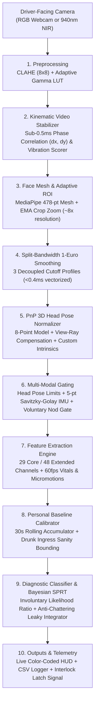

# The Overclocked: Driver Monitoring System (DMS)

[](https://www.python.org/)
[]()
[](https://opensource.org/licenses/MIT)

An advanced, edge-optimized Driver Monitoring System (DMS) that measures micro-movements of the eyelids, irises, forehead, cheeks, and head from a single driver-facing camera (RGB webcam or monochrome Near-Infrared / 940nm NIR). The system investigates whether involuntary neurological reflexes and autonomic vitals can be distinguished from conscious, voluntary masking maneuvers to detect driver impairment and fatigue in real time.

> **Status: Research Prototype & Proof of Concept. Not Clinically Validated.**  
> No model in this repository has been clinically validated against certified blood alcohol concentration (BAC) or medical-grade polysomnography (PSG). Every threshold marked `[PLACEHOLDER]` represents an uncalibrated design target pending empirical calibration against real impairment datasets (such as Toyota IDD). This software has not undergone functional safety audits. Safety architecture is ASIL-inspired but **not certified** under ISO 26262.

---

## Table of Contents
1. [Project Status & Test Suite](#project-status--test-suite)
2. [What This Project Can and Cannot Claim](#what-this-project-can-and-cannot-claim)
3. [End-to-End Pipeline Architecture](#end-to-end-pipeline-architecture)
4. [Key Engineering Innovations](#key-engineering-innovations)
5. [Landmark Topology & Anatomical Conventions](#landmark-topology--anatomical-conventions)
6. [Feature Extraction Architecture (29 Core vs. 48 Extended Channels)](#feature-extraction-architecture)
7. [Involuntary Reflexes vs. Voluntary Gaming (Anti-Masking)](#involuntary-reflexes-vs-voluntary-gaming-anti-masking)
8. [Personal Baseline Calibration & Drunk Ingress Bounding](#personal-baseline-calibration--drunk-ingress-bounding)
9. [Sequential Bayesian Evidence Filter (Wald SPRT)](#sequential-bayesian-evidence-filter-wald-sprt)
10. [Data Ingestion & Training Pipeline (Toyota IDD)](#data-ingestion--training-pipeline-toyota-idd)
11. [Installation & Quick Start Guide](#installation--quick-start-guide)
12. [Repository Directory Structure](#repository-directory-structure)
13. [Ethics, Privacy & Regulatory Compliance](#ethics-privacy--regulatory-compliance)
14. [License](#license)

---

## Project Status & Test Suite

| Component | Engineering Implementation Status |
| :--- | :--- |
| **Automated Test Suite** | **187 / 187 automated tests passing** across 16 test modules (`pytest tests/ -v`). Executes in $< 60\text{ s}$. |
| **Zero-Blur Kinematic Video Stabilizer** | **Implemented.** Sub-0.5ms phase correlation translation tracker & high-frequency chassis vibration scorer in coordinate space without pixel blurring (`pipeline/stabilizer.py`). |
| **Adaptive ROI Tracker & Multi-Scale Zoom** | **Implemented.** Tracks smoothed 2D face bounding box with EMA temporal smoothing ($\alpha=0.15$) and crops an expanded $2.0\times$ ROI directly from the raw frame, boosting effective face resolution $\sim 8\times$ for distant drivers at 1.5–2.0m (`pipeline/face_mesh_detector.py`). |
| **Head Pose & PnP Normalization** | **Implemented.** Robust `cv2.solvePnP` with temporal extrinsic guess reuse, view-ray angle compensation, mirror $\pm 42^\circ$ yaw bifurcation suppression, and support for custom `.json` / `.npz` camera calibration intrinsics (`pipeline/pnp_normalizer.py`). |
| **Oculomotor Feature Engine** | **Implemented.** Conjugate horizontal camera axis mapping ($[-1, 1]$), calibrated saccade velocity ($22^\circ/\text{unit}$ scale), Gaze-Evoked Nystagmus (GEN), binocular vergence, and Vestibulo-Ocular Reflex (VOR gain) with steep pitch & eccentric gaze gating (`pipeline/feature_extractor.py`). |
| **Facial Micromotions & Autonomous Vitals (60fps)** | **Implemented.** Brow-to-canthus elevation ratio & frontalis ptosis compensation ($\ge +12\%$), palpebral tremor / eyelid flutter (3–15 Hz), and T-zone green-channel rPPG pulse (BPM) & HRV RMSSD (`pipeline/feature_extractor.py`). |
| **Dual-Mode Training Buffer** | **Implemented.** Supports 29-channel core mode (default, for backwards compatibility) and 48-channel extended mode with dynamic boolean slicing and column-aligned multi-archive union loading (`pipeline/training_buffer.py`, `train_baseline.py`). |
| **Thread Safety & Exception Hardening** | **Implemented.** Thread-safe feature extraction protected by reentrant locks (`threading.RLock`) and surgical exception handling replacing generic blanket try/catches. |
| **Rule-Based Classifier & Bayesian Filter** | **Implemented.** Rule-based diagnostic classifier with NIR chromaticity weight reallocation and continuous Wald SPRT sequential evidence accumulation (`pipeline/classifier.py`, `pipeline/bayesian_filter.py`). Thresholds marked `[PLACEHOLDER]`. |
| **Vehicle Interlock (Starter & Throttle)** | **Software logic & latching signals implemented.** Physical relays, CAN bus transceivers, and actuators not built. |

---

## What This Project Can and Cannot Claim

### What this project CAN claim:
- A modular, reproducible, high-performance edge perception pipeline running at 30–60+ FPS on standard CPU hardware.
- High-precision geometric and kinematic signal extraction that isolates driver movements from vehicle cabin bounce and road shocks.
- Comprehensive non-regression protection backed by **187 automated unit, invariant, and integration tests**.
- A disciplined physiological framework that explicitly differentiates between subcortical involuntary reflexes and conscious voluntary masking attempts.

### What this project CANNOT claim:
- **It does not detect intoxication in production.** Thresholds are uncalibrated placeholders pending real-world dataset fitting.
- **No biomarker is "unfakeable."** While involuntary reflexes (such as smooth pursuit degradation or nystagmus) are difficult to simulate, optical noise, lighting changes, contact lenses, fatigue, or illness can introduce false positives.
- **It is not certified under ISO 26262.** Automotive functional safety compliance requires full process audits, formal Hazard Analysis and Risk Assessment (HARA), ASIL decomposition, and safety-qualified compilers/runtimes.
- **Regulatory limits:** In India, the legal limit for commercial/private drivers is $0.03\%\text{ BAC}$ ($30\text{ mg}/100\text{ mL}$). Passive computer vision systems typically observe measurable degradation from roughly $0.05\%\text{ BAC}$ upward. Detecting subtle impairment at $0.03\%\text{ BAC}$ requires multi-modal sensor fusion (e.g., secondary passive ethanol breath sensors).

---

## End-to-End Pipeline Architecture

The pipeline processes raw camera frames through strictly decoupled, sequential stages:



---

## Key Engineering Innovations

### 1. Zero-Blur Kinematic Video & Landmark Stabilizer (`pipeline/stabilizer.py`)
Traditional software image stabilization warps pixels via homography or affine transformations, which degrades high-frequency pixel clarity and blurs eyelid and iris contours. 
- Operates strictly in **coordinate space** and **ROI window space** without modifying pixel buffers.
- Estimates instantaneous horizontal and vertical chassis shifts $(dx, dy)$ in $< 0.3\text{ ms}$ using downsampled Fourier phase correlation.
- Computes a high-frequency **chassis vibration score** ($3\text{--}15\text{ Hz}$ oscillatory sign-reversals) and flags speed bumps ($> 12\text{ px}$ vertical impulse).
- Adjusts bounding box extraction coordinates dynamically, completely decoupling vehicle vibration from facial movements.

### 2. Adaptive ROI Tracker for Distant Drivers (`pipeline/face_mesh_detector.py`)
Standard MediaPipe Face Mesh downsamples full-resolution frames to $192 \times 192\text{ px}$. When a driver sits $1.5\text{--}2.0\text{ m}$ away, their face covers $< 100\text{ px}$ in a 720p frame, shrinking to $< 15\text{ px}$ in the model and causing severe landmark dropout.
- Implements an **Adaptive ROI Tracker** that tracks the face center $(c_x, c_y)$ and scale with Exponential Moving Average (EMA, $\alpha=0.15$) and a 2-pixel deadband to eliminate crop flutter.
- Crops an expanded $2.0\times$ bounding box directly from the raw frame and feeds the crop to MediaPipe, where the face occupies $60\text{--}80\%$ of the model receptive field (an effective $\approx 8\times$ resolution gain).
- Remaps crop-relative coordinates back to global camera coordinates with subpixel precision.
- Incorporates a **Central Driver Quadrant** fallback ($[0.2W, 0.1H]$ to $[0.8W, 0.85H]$) when the driver is initially seated at a distance.

### 3. PnP Head Pose Normalization & Yaw Bifurcation Fix (`pipeline/pnp_normalizer.py`)
To isolate internal facial muscle movements (blinking, yawning, ocular tracking) from vehicle bounce and head movement:
- Employs `cv2.solvePnP` with `SOLVEPNP_ITERATIVE` and temporal extrinsic reuse ($r_{\text{vec}}, t_{\text{vec}}$) against an expanded 8-point canonical skull model (`CANONICAL_FACE_3D_8` adding the nose bridge 168 and glabella 9).
- **Yaw Bifurcation Suppression:** Human faces narrower than canonical models previously caused PnP to oscillate between mirror $\pm 42^\circ$ yaw minima; our temporal seeding and anchor expansion prevent this flipping.
- **View-Ray Angle Compensation:** Adjusts apparent yaw and pitch based on the ray direction from the camera optical center to the driver's head, ensuring that off-center cameras do not introduce systematic bias.
- **Camera Intrinsics Support:** Accepts custom focal lengths (`focal_length_px`) and loads OpenCV camera calibration files (`.json` and `.npz`) via `calibration_path` or `PnPNormalizer.from_calibration_file()`. Maintains calibrated optical centers and focal lengths proportionally across resolution updates.

### 4. Split-Bandwidth Vectorized 1-Euro Filter (`pipeline/one_euro_filter.py`)
Landmark tracking in vehicles suffers from a fundamental trade-off: aggressive smoothing removes detector jitter but creates lag during rapid saccades or blinks.
- Fully vectorized NumPy implementation filtering all 478 landmarks simultaneously in $< 0.4\text{ ms}$.
- Uses **three decoupled bandwidth profiles**:
  - **Rigid Skull Anchors (460 points):** Strong resting smoothing ($f_{\text{c,min}} = 0.8\text{ Hz}$, $\beta=0.04$) to guarantee a rock-solid PnP coordinate foundation.
  - **Eyelid Margins (28 points):** High-speed response ($f_{\text{c,min}} = 2.0\text{ Hz}$, $\beta=0.50$, $f_{\text{d}} = 8.0\text{ Hz}$) to capture sub-100ms blink downstrokes without clipping peak velocities.
  - **Iris Centers & Rings (10 points):** Dedicated ocular tracking profile ($f_{\text{c,min}} = 1.5\text{ Hz}$, $\beta=0.55$, $f_{\text{d}} = 8.0\text{ Hz}$) that preserves 20–50ms rapid saccadic jumps while suppressing detector tremor.

### 5. Multi-Modal Gating & Voluntary Nod Decoupling (`pipeline/imu_gate.py`, `pipeline/head_pose_estimator.py`)
- **Software IMU Gate:** Uses a 5-point non-uniform Savitzky-Golay quadratic polynomial fit on 3D nose-tip translation from PnP to calculate instantaneous linear acceleration. Freezes feature buffers for 150ms if acceleration exceeds $2.5\text{ m/s}^2$ without head rotation ($\dot{\theta} < 20^\circ/\text{s}$), rejecting potholes and speed bumps.
- **Voluntary Nod Decoupling:** Distinguishes intentional head nodding (e.g., checking blind spots or nodding to music) from cerebellar postural sway ataxia. If head pitch/roll angular velocity exceeds $35.0^\circ/\text{s}$, sway accumulators safely pause and reset without triggering false positives.

---

## Landmark Topology & Anatomical Conventions

All landmark indices adhere to the MediaPipe 478-point mesh specification (anatomical left/right conventions):

```
       Viewer's Left (Subject's Right Eye)              Viewer's Right (Subject's Left Eye)
                 [33] Outer Canthus                               [263] Outer Canthus
                 [133] Inner Canthus                              [362] Inner Canthus
                 [473] Iris Center                                [468] Iris Center
                 [474-477] Iris Ring                              [469-472] Iris Ring
```

### Key Landmark Indices
- **Eye Aspect Ratio (EAR, 6-Point Soukupová & Čech):**
  - **Right Eye:** $P_1=33$ (outer), $P_2=160$, $P_3=158$, $P_4=133$ (inner), $P_5=153$, $P_6=144$
  - **Left Eye:** $P_1=263$ (outer), $P_2=385$, $P_3=387$, $P_4=362$ (inner), $P_5=373$, $P_6=380$
- **Mouth Aspect Ratio (MAR, Dense 3-Pair Formula):**
  - Horizontal corners: 61 (right), 291 (left)
  - Vertical pairs: $(81, 178)$, $(13, 14)$ (inner lips midpoint), $(311, 402)$
- **Forehead Coverage (T-Zone & Frontalis):**
  - **`FOREHEAD_CONTOUR` (27 points):** Closed perimeter loop spanning the hairline arc (`127 -> 10 -> 356`) and supraorbital brow arch (`356 -> 9 -> 127`).
  - **`FOREHEAD_PATCH` (20 points):** Interior frontal bone points for rPPG and vasodilation tracking.
- **Full Cheek Matrices:**
  - 22 points per side (44 total) covering the infraorbital margin, malar apple, zygomatic arch, and buccal zones, enclosed by 9-vertex closed perimeter outlines (`RIGHT_CHEEK_OUTLINE`, `LEFT_CHEEK_OUTLINE`).
- **Vasodilation & rPPG Zone:**
  - 64 facial landmarks (`VASODILATION_LANDMARKS = FULL_CHEEK_LANDMARKS + FOREHEAD_PATCH`).

---

## Feature Extraction Architecture

The system provides dual-mode feature generation via [`TrainingBuffer`](file:///C:/Users/Akhileshwar%20Subbiah/.gemini/antigravity/scratch/driver-monitor/pipeline/training_buffer.py):
1. **Core Mode (29 Channels):** Default mode preserving exact 29-element feature vector compatibility for standard models.
2. **Extended Mode (48 Channels):** Enabled via `include_extended_features=True` in `idd_ingest.py` and `train_baseline.py`, capturing all 33 continuous physiological signals and 15 discrete behavioral/masking flags.

| Category | Channel Count | Signals & Descriptions |
| :--- | :--- | :--- |
| **Eyelid Kinetics & Tremor** | 7 numeric + 2 bool | EAR (left, right, average), blink closing velocity, blink opening velocity, PERCLOS (O(1) circular ring counter), palpebral flutter / eyelid tremor frequency (3–15 Hz zero-crossing rate on sub-millimeter $\Delta\text{EAR}$). Flags: `blink_detected`, `microsleep_detected`. |
| **Gaze & Saccadic Dynamics** | 5 numeric + 1 bool | Normalized iris x/y per eye (aligned conjugate frame axis $+X$ image right), saccade angular velocity ($22^\circ/\text{unit}$ scale, bilateral maximum $\max(|dx_l|, |dx_r|)$ for squint/glare immunity), saccade latency (reaction time proxy), gaze yaw dispersion ($\sigma_{\text{yaw}}$). Flag: `saccade_detected`. |
| **Advanced Oculomotor** | 4 numeric + 2 bool | Gaze-Evoked Nystagmus (GEN slow-phase drift velocity and corrective beat count), smooth pursuit fragmentation ratio, binocular vergence angle (degrees). Flags: `gen_detected`, `lack_of_convergence` (LOC, gated on steep pitch and lateral gaze). |
| **Head Pose & Posture** | 5 numeric | PnP Head Yaw, Pitch, Roll (with camera view-ray compensation), Vestibulo-Ocular Reflex (VOR micro-gain), seated head postural sway residual ($\sqrt{\sigma_{\text{pitch}}^2 + \sigma_{\text{roll}}^2}$). |
| **Mouth & Respiration** | 1 numeric + 1 bool | MAR (dense 3-pair normalized formula). Flag: `yawn_detected`. |
| **Forehead & Brow Micromotions** | 4 numeric + 1 bool | Brow-to-canthus elevation ratio (normalized by outer inter-canthal width), brow elevation delta from baseline, stare fixation duration (seconds), compensatory stare spatial variance. Flag: `frontalis_compensation_active` ($\ge +12\%$ elevation indicating ptosis resistance). |
| **Autonomic Vitals & Flushing** | 5 numeric + 4 bool | T-zone green-channel rPPG pulse rate (BPM, $0.75\text{--}2.5\text{ Hz}$ bandpass), heart rate variability (HRV RMSSD in ms), facial flushing chromaticity ratio ($R / \frac{G+B}{2}$) and delta from baseline across cheeks/forehead (RGB only, safely bypassed under NIR). Flags: `flushing_valid`, `rppg_valid`, `deliberate_blink_suppression`, `voluntary_eye_widening`. |
| **System & Safety Gating** | 2 bool + 2 numeric | Flags: `imu_gated`, `masking_detected`. Numeric: postural sway detrended, anti-masking kinetic discordance score ($M_{\text{mask}}$). |

---

## Involuntary Reflexes vs. Voluntary Gaming (Anti-Masking)

Impaired drivers often attempt to "game" vision-based monitoring systems by deliberately staring forward, opening their eyes wide, or keeping their neck rigid. Our architecture decouples drivers' conscious efforts from autonomic degradation:

```
┌────────────────────────────────────────────────────────────────────────┐
│                   SECTION A: INVOLUNTARY BIOMARKERS                    │
│   (Subcortical, Brainstem & Autonomic - Primary Diagnostic Authority)   │
├──────────────────────────────────────┬─────────────────────────────────┤
│ • Gaze-Evoked Nystagmus (GEN)        │ • Involuntary Blink Reopening   │
│ • Smooth Pursuit Fragmentation       │ • Palpebral Flutter (3-15 Hz)   │
│ • VOR Gain Depression                │ • Cerebellar Postural Sway      │
│ • Lack of Convergence (Strabismus)   │ • T-Zone Microvascular Flushing │
└──────────────────────────────────────┴─────────────────────────────────┘
                                ▲
                                │ Anti-Masking Divergence Metric (M_mask)
                                ▼
┌────────────────────────────────────────────────────────────────────────┐
│             SECTION B: VOLUNTARY & COMPENSATORY BEHAVIORS              │
│       (Cortical, Conscious Motor Actions - Gaming Risk Indicators)      │
├──────────────────────────────────────┬─────────────────────────────────┤
│ • Deliberate Blink Suppression (>6s) │ • Frontalis Ptosis Compensation │
│ • Compensatory Stare Fixation (>6s)  │ • Rigid Neck/Cervical Locking   │
│ • Voluntary Eye-Widening Spikes      │                                 │
└──────────────────────────────────────┴─────────────────────────────────┘
```

- **Section A (Involuntary Reflexes):** Governs primary impairment probability in the Bayesian accumulator. These autonomic and brainstem reflexes cannot be consciously controlled.
- **Section B (Voluntary Behaviors):** Tracked to identify conscious effort.
- **Anti-Masking Divergence Metric ($M_{\text{mask}}$):** Measures discordance when voluntary effort is high while involuntary reflexes are degraded. When discordance exceeds 50%, an anti-masking event is logged.

---

## Personal Baseline Calibration & Drunk Ingress Bounding

To prevent false alarms caused by natural anatomical variations (e.g., naturally small eyes, facial asymmetry, or high baseline blink rates):
- **Dynamic Baseline Calibration (`pipeline/calibration.py`):** Driver baselines (awake EAR, resting MAR, blink upstroke velocity, resting posture, and facial chromaticity) are accumulated over the initial 30–60 seconds of driving.
- **Drunk Ingress Protection:** If an impaired driver enters the vehicle already impaired, calibrating to their entry state would adapt the system to an impaired baseline. The calibrator enforces strict physiological bounds:
  $$\text{EAR}_{\text{baseline}} \in [0.25, 0.38] \quad (\text{median sober } \approx 0.28)$$
  $$v_{\text{up, baseline}} \in [1.80, 3.20]\text{ EAR/s} \quad (\text{median sober } \approx 2.50\text{ EAR/s})$$
  $$\text{Asymmetry}_{\text{baseline}} \le 0.05$$
- If an entering driver exhibits ptosis ($\text{EAR} < 0.25$) or sluggish kinetics ($v_{\text{up}} < 1.80$), `ingress_impairment_detected = True` triggers immediately, clamping baselines to conservative population norms rather than learning the impaired state.

---

## Sequential Bayesian Evidence Filter (Wald SPRT)

Rather than evaluating each frame in isolation, [`pipeline/bayesian_filter.py`](file:///C:/Users/Akhileshwar%20Subbiah/.gemini/antigravity/scratch/driver-monitor/pipeline/bayesian_filter.py) implements **Wald’s Sequential Probability Ratio Test (SPRT)** to accumulate evidence over time:
- **Log-Odds Update:** 
  $$\Lambda_{t} = \Lambda_{t-1} + \ln \left( \frac{P(\text{biomarkers} \mid \text{Impaired})}{P(\text{biomarkers} \mid \text{Sober})} \right) - \lambda \cdot \Delta t$$
- **Anti-Chattering Leaky Integrator:** Includes a graceful decay term ($-2.0 \cdot \Delta t$) ensuring that transient optical noise or brief single-frame anomalies do not permanently elevate the risk level.
- **Sustained Lockout Threshold:** To arm a starter lockout or vehicle interlock signal, the posterior probability must satisfy $P(\text{Impaired}) \ge 0.999$ sustained continuously for $\ge 15.0\text{ seconds}$.
- **Hardware Fail-Safe:** Once armed, the interlock enters a latching state that clears only when the vehicle is verified to be in Park gear.

---

## Data Ingestion & Training Pipeline (Toyota IDD)

The repository provides a complete ingestion and training workflow for research datasets:

### 1. Ingestion (`idd_ingest.py`)
- Discovers driving clips and annotations from the **Toyota Impaired Driving Dataset (IDD)**.
- Runs each clip through the full perception pipeline: CLAHE $\to$ Stabilizer $\to$ Face Mesh $\to$ 1-Euro Filter $\to$ PnP Normalizer $\to$ Feature Extractor.
- Packages features into rolling temporal window tensors (default $5.0\text{s}$ window, $2.5\text{s}$ stride) saved as `.npz` archives.

### 2. Multi-Subject Cross-Validation (`train_baseline.py`)
- **Strict GroupKFold:** Splits data strictly across `subject_id` boundaries, guaranteeing that no participant appears in both training and test folds (zero subject data leakage).
- **Heterogeneous Archive Alignment:** [`load_dataset_from_npz()`](file:///C:/Users/Akhileshwar%20Subbiah/.gemini/antigravity/scratch/driver-monitor/train_baseline.py#L219-L282) creates an aligned union schema across mixed archives, supporting 29-channel and 48-channel datasets simultaneously.
- **Window Summary Statistics:** Transforms 3D window tensors $(N, \text{frames}, \text{features})$ into 2D tabular features via 7 statistical operators per channel ($\text{mean}, \text{std}, \text{min}, \text{max}, \text{median}, p_{10}, p_{90}$).
- **Involuntary Feature Filtering:** Excludes voluntary Section B masking metrics from impairment classifier training to prevent compensatory maneuvers from confounding models.

---

## Installation & Quick Start Guide

Compatible with Python 3.9 through 3.14 on Windows, Linux, and macOS.

### 1. Clone & Install
```bash
# Clone the repository
git clone https://github.com/Thanos3541R/The_Overclocked.git
cd The_Overclocked

# Install required dependencies
pip install -r requirements.txt
```

### 2. Live Driver Monitoring with HUD Overlay
```bash
# Launch live camera (webcam index 0 or NIR sensor)
python main.py

# Launch on a recorded driving clip with full CSV feature logging
python main.py --source /path/to/video.mp4 --save-csv --csv-path ./driver_telemetry.csv

# Run headless (no GUI window, high-throughput logging)
python main.py --source /path/to/video.mp4 --headless --save-csv
```

**HUD Interactive Hotkeys:**
- Press `[v]` to cycle overlay modes: `regions` (key anatomical regions) $\to$ `full` (complete 478-point wireframe) $\to$ `off` (unobstructed video).
- Press `[q]` or `[ESC]` to exit.

### 3. Forensic Video Extraction & Audit Report
```bash
python extract_video_features.py --video /path/to/video.mp4 --output-dir ./audit_report/
```
Generates 3 forensic artifacts:
- `video_features_report.txt`: Clinical and forensic summary detailing Section A involuntary markers, Section B masking attempts, and interlock lockout status.
- `video_features.csv`: Frame-by-frame time-series of all physiological signals.
- `video_features_summary.json`: Machine-readable diagnostic metrics and ML risk payload.

### 4. Single Image & Video Diagnostics
```bash
# Inspect a static driver image
python inspect_driver.py --image /path/to/photo.jpg

# Capture a single frame from the camera and inspect
python inspect_driver.py --capture

# Inspect a video clip
python inspect_driver.py --video /path/to/video.mp4
```

### 5. Toyota IDD Ingestion & Model Benchmark
```bash
# Ingest raw Toyota IDD video dataset into windowed 48-channel .npz tensors
python idd_ingest.py --idd-root /path/to/idd_data/ --output-dir ./idd_output/

# Run synthetic multi-subject benchmark (self-contained verification without external data)
python train_baseline.py --test-synthetic

# Train model on ingested dataset archives
python train_baseline.py --data-dir ./idd_output/ --output-model models/trained_model.joblib
```

### 6. Run Complete Test Suite
```bash
python -m pytest tests/ -v
```
Executes all **187 unit, geometric, invariance, thread-safety, and integration tests** in $< 60\text{ seconds}$ with a 100% pass rate.

---

## Repository Directory Structure

```
The_Overclocked/
├── config.py                 # Central configuration dataclass (camera, PnP, and feature thresholds)
├── main.py                   # Real-time DMS application with HUD visualization & CSV logging
├── inspect_driver.py         # Diagnostic tool for single-image, live capture, or video inspection
├── extract_video_features.py # Batch video analyzer with Section A/B report generation
├── idd_ingest.py             # Batch ingestion engine for Toyota IDD driving dataset (48-channel)
├── train_baseline.py         # Multi-subject ML training with GroupKFold & union archive schema
├── requirements.txt          # Python package dependencies
├── models/
│   ├── face_landmarker.task  # MediaPipe 478-point landmark bundle (auto-downloads if absent)
│   └── baseline_impairment_model.joblib # Trained pipeline proof-of-concept model artifact
├── pipeline/
│   ├── frame_capture.py       # Polymorphic camera/video reader (DirectShow, MJPG, RGB & NIR)
│   ├── preprocessing.py       # CLAHE & adaptive Gamma LUT low-light enhancer
│   ├── stabilizer.py          # Zero-blur kinematic video & chassis vibration stabilizer (<0.5ms)
│   ├── face_mesh_detector.py  # MediaPipe Face Mesh with AdaptiveROITracker & Multi-Scale Zoom
│   ├── one_euro_filter.py     # Vectorized 3-bandwidth temporal low-pass filter (<0.4ms)
│   ├── pnp_normalizer.py      # Robust solvePnP pose estimation, view-ray fix & calibration loader
│   ├── head_pose_estimator.py # Head pose gating & tracking
│   ├── imu_gate.py            # 5-point Savitzky-Golay quadratic IMU shock gate
│   ├── feature_extractor.py   # 48-signal physiological feature extractor + thread-safe RLock
│   ├── calibration.py         # Personal baseline calibrator with Drunk Ingress sanity bounding
│   ├── classifier.py          # Diagnostic classifier with NIR chromaticity weight redistribution
│   ├── bayesian_filter.py     # Sequential Bayesian evidence accumulator with Wald SPRT
│   └── training_buffer.py     # Dual-mode (29-channel core / 48-channel extended) windowed tensor buffer
├── utils/
│   ├── landmarks.py           # Canonical 3D models, MediaPipe constants, forehead & full cheek indices
│   ├── overlay_regions.py     # 9 color-coded HUD overlay regions with vectorized batch drawing
│   └── visualization.py       # OpenCV HUD telemetry display & region legend
└── tests/
    ├── sample_driver_video.mp4 # Video fixture for regression & invariance benchmarking
    └── test_*.py              # 16 test modules (187 automated unit, invariance & integration tests)
```

---

## Ethics, Privacy & Regulatory Compliance

- **Biometric Privacy:** Video streams contain sensitive facial biometric data. The pipeline is designed for edge computing: frames are processed in volatile memory and are not persisted to disk or transmitted over networks unless explicitly requested via CLI arguments.
- **Informed Consent:** In accordance with India's **Digital Personal Data Protection Act (DPDPA), 2023**, and international privacy standards (GDPR), deployment in vehicles requires verifiable driver consent, clear purpose specification, and user rights mechanisms.
- **Non-Diagnostic Nature:** All risk indicators, scores, and interlock outputs produced by this software are experimental research metrics and must not be used as clinical, toxicological, or legal evidence of intoxication.

---

## License

This project is licensed under the [MIT License](LICENSE).
