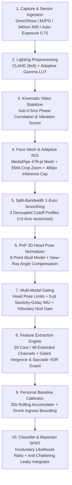

<div align="center">

# ⚡ The Overclocked: Driver Monitoring System (DMS)
### Edge-Optimized Involuntary Neuro-Reflexes & Anti-Masking Telemetry

[](https://github.com/Thanos3541R/The_Overclocked/actions/workflows/ci.yml)
[]()
[](https://www.python.org/)
[](https://opensource.org/licenses/MIT)
[]()
[]()

<p align="center">
  <b>A real-time, edge-grade computer vision pipeline that isolates involuntary brainstem reflexes from conscious facial masking to detect driver impairment and fatigue.</b><br>
  Operates on standard commodity RGB webcams or monochrome 940nm Near-Infrared (NIR) sensors with zero cloud dependency.
</p>

</div>

---

> [!IMPORTANT]
> **Research Prototype & Proof of Concept — Not Clinically Validated**  
> This system is an engineering research testbed exploring whether subcortical neurological reflexes can be reliably decoupled from voluntary facial maneuvers. All numeric risk thresholds marked `[PLACEHOLDER]` represent uncalibrated algorithmic targets pending empirical calibration against certified medical-grade polysomnography (PSG) or legal blood alcohol concentration (BAC) callsets. Safety architecture is ASIL-inspired but **not certified** under ISO 26262.

---

## 📑 Table of Contents
1. [Quick Start in 60 Seconds](#-quick-start-in-60-seconds)
2. [Why Traditional DMS Fails (The Anti-Masking Core)](#-why-traditional-dms-fails-the-anti-masking-core)
3. [End-to-End Pipeline Architecture](#-end-to-end-pipeline-architecture)
4. [Key Engineering Innovations](#-key-engineering-innovations)
5. [Involuntary Reflexes vs. Voluntary Gaming (Section A vs. B)](#-involuntary-reflexes-vs-voluntary-gaming)
6. [48-Channel Physiological Feature Dictionary](#-48-channel-physiological-feature-dictionary)
7. [Personal Baseline Calibration & Drunk Ingress Clamping](#-personal-baseline-calibration--drunk-ingress-clamping)
8. [Sequential Bayesian Evidence Accumulator (Wald SPRT)](#-sequential-bayesian-evidence-accumulator-wald-sprt)
9. [Command-Line Tools & CLI Cheatsheet](#-command-line-tools--cli-cheatsheet)
10. [Repository Directory Structure](#-repository-directory-structure)
11. [Ethics, Privacy & Regulatory Compliance](#-ethics-privacy--regulatory-compliance)
12. [License](#-license)

---

## 🚀 Quick Start in 60 Seconds

### 1. Installation
Ensure you are using **Python 3.9, 3.10, or 3.11 (64-bit)** for plug-and-play binary wheel support:

```bash
# Clone the repository
git clone https://github.com/Thanos3541R/The_Overclocked.git
cd The_Overclocked

# Install core dependencies (OpenCV, MediaPipe, NumPy, SciPy, scikit-learn)
pip install -r requirements.txt
```

### 2. Launch Real-Time Monitoring
Connect any standard USB webcam or NIR camera and launch the live HUD:

```bash
# Launch live camera feed with real-time HUD & telemetry
python main.py

# Or run on a pre-recorded video clip and save both CSV telemetry & annotated video:
python main.py --source "path/to/clip.mp4" --output-csv "features.csv" --output "annotated_clip.mp4"

# Or run headless for high-throughput batch extraction:
python main.py --source "path/to/clip.mp4" --headless --output-csv "features.csv"
```

**Live HUD Interactive Controls:**
- **`[v]`**: Cycle landmark overlays: `Key Regions` $\to$ `Full 478-Point Mesh` $\to$ `Solid Part Masking` $\to$ `Off`.
- **`[1-8]`**: Selectively toggle solid part highlights (`[1]` Forehead, `[2]` Cheeks, `[3]` Chin, `[4]` Lips, `[5]` Eyes, `[6]` Nose, `[7]` Eyebrows, `[8]` Full Face) or **`[0]`** to toggle all.
- **`[r]`**: Toggle the **Adaptive ROI Zoom Box** displaying the dynamic $2.0\times$ face crop tracker.
- **`[s]`**: Toggle real-time visual video stabilization on the display window.
- **`[p]`**: Pause or resume video stream playback.
- **`[u]`**: Simulate vehicle **PARK gear** (unlatches Bayesian interlock and resets classifier state).
- **`[q]`** or **`[ESC]`**: Safely exit and flush streaming CSV and video output.

### 3. Run Complete Automated Test Suite
Verify that all 294 automated unit, invariance, geometric, and integration tests pass on your machine:

```bash
python -m pytest tests/ -v
```
*(All 294 tests execute in $< 60\text{ seconds}$ with a 100% pass rate).*

---

## 🧠 Why Traditional DMS Fails (The Anti-Masking Core)

Most production Driver Monitoring Systems rely solely on simple heuristics:
- **Eye Aspect Ratio (EAR):** How wide are the eyelids open?
- **PERCLOS:** What percentage of time are eyes closed over a 60-second window?

### The Fatal Flaw: The Driver "Fights Back"
When a tired or intoxicated driver realizes they are nodding off, they consciously compensate:
1. They **force their eyes open wide** (causing artificial EAR spikes).
2. They **lock their gaze forward in a frozen catatonic stare** (suppressing blinks for 6–10 seconds).
3. They **flex their frontalis forehead muscles** to mechanically pull droopy eyelids upward.

A standard vision-based monitor marks this driver as *"100% Alert"*. Seconds later, the driver suffers a catastrophic microsleep.

### Our Solution: Subcortical Involuntary Reflexes
While a driver can consciously control their gross eyelid opening, they **cannot consciously fake autonomic and brainstem reflexes**:

```
                       ┌──────────────────────────────────────────────┐
                       │           RAW VIDEO FEED (RGB/NIR)           │
                       └──────────────────────┬───────────────────────┘
                                              │
                    ┌─────────────────────────┴─────────────────────────┐
                    ▼                                                   ▼
┌───────────────────────────────────────┐   ┌───────────────────────────────────────┐
│   SECTION A: INVOLUNTARY REFLEXES     │   │   SECTION B: VOLUNTARY COMPENSATIONS  │
│  (Subcortical, Brainstem & Autonomic) │   │     (Cortical, Conscious Motor Acts)  │
├───────────────────────────────────────┤   ├───────────────────────────────────────┤
│ • Eyeball Micro-Tremor (3–7 Hz)       │   │ • Deliberate Blink Suppression (>6s)  │
│ • Gaze-Evoked Nystagmus (GEN) drift   │   │ • Forced Compensatory Stare (>6s)     │
│ • Smooth Pursuit Saccadic Jumps       │   │ • Voluntary Eye-Widening Spikes       │
│ • Sluggish Blink Upstroke Velocity    │   │ • Frontalis Brow-Raising Ptosis Lift  │
│ • Vestibulo-Ocular Reflex Depression  │   │ • Rigid Neck / Cervical Spine Lock    │
│ • T-Zone Microvascular Flushing (rPPG)│   │                                       │
│ • Lack of Convergence (LOC strabismus)│   │                                       │
└───────────────────┬───────────────────┘   └───────────────────┬───────────────────┘
                    │                                           │
                    └─────────────────────┬─────────────────────┘
                                          ▼
                      ┌───────────────────────────────────────┐
                      │    ANTI-MASKING DIVERGENCE METRIC     │
                      │               (M_mask)                │
                      │  Detects when high voluntary effort   │
                      │  co-occurs with reflex degradation    │
                      └───────────────────┬───────────────────┘
                                          ▼
                      ┌───────────────────────────────────────┐
                      │    SEQUENTIAL BAYESIAN FILTER (SPRT)  │
                      │    Continuous log-odds accumulator    │
                      │    with anti-chattering leaky decay   │
                      └───────────────────┬───────────────────┘
                                          ▼
                      ┌───────────────────────────────────────┐
                      │     VEHICLE INTERLOCK DECISION        │
                      │   (Sober / Caution / Latching Lockout)│
                      └───────────────────────────────────────┘
```

When high voluntary effort is observed simultaneously with degrading subcortical reflexes, the system calculates an elevated **Anti-Masking Divergence Score ($M_{\text{mask}}$)** and triggers protective vehicle countermeasures.

---

## 🛠️ End-to-End Pipeline Architecture

The pipeline processes raw camera frames through 10 strictly decoupled, zero-copy modular stages:



---

## 🌟 Key Engineering Innovations

### 1. High-Throughput Camera Engine & DirectShow Optimization (`pipeline/frame_capture.py`)
- **DirectShow MJPG Stream Negotiation:** Negotiates `MJPG` fourcc and sets `CAP_PROP_BUFFERSIZE = 1` to eliminate buffer latency.
- **Auto-Exposure Persistence Prevention:** Explicitly sets `CAP_PROP_AUTO_EXPOSURE = 0.75` on live cameras so webcams never remain stuck in dark manual exposure settings from previous sessions.
- **Anti-Motion Blur Mode:** Optional `--anti-motion-blur` flag locks exposure to $-6$ ($1/64\text{ s}$) with fixed gain for high-speed night-driving scenarios.
- **Asynchronous Worker Thread:** Uses condition variable notifications and yields the GIL cleanly with micro-sleeps to deliver steady 30–60 FPS capture.

### 2. High-FPS MediaPipe Inference Scaling (`pipeline/face_mesh_detector.py`)
- **Proportional 480px Inference Cap:** If frame width $w > 480$, frames are smoothly resized to $480 \times \text{round}(h \times \frac{480}{w})$ via `cv2.INTER_AREA` for MediaPipe detection, achieving $> 60\text{ FPS}$ pipeline throughput while remapping 3D landmarks back to native image coordinates with subpixel precision.
- **Adaptive ROI Zoom Tracker:** Tracks the face bounding box using Exponential Moving Average (EMA, $\alpha=0.15$) and feeds a focused $2.0\times$ face crop directly into the detector, granting distant drivers an effective $\approx 8\times$ resolution boost.
- **Quadrant Recovery Fallback:** Searches the driver's central quadrant ($[0.2W, 0.1H]$ to $[0.8W, 0.85H]$) if tracking is temporarily lost.

### 3. Saccade Dynamics, Occlusion Guard & VOR Suppression (`pipeline/feature_extractor.py`)
- **Blink & Eyelid-Motion Occlusion Guard:** When eyelids are in closing, closed, or opening phases, iris tracking holds over without latching false saccades.
- **Physical 2D Socket Translation Guard:** Distinguishes genuine head motion from stationary PnP Euler jitter. Vestibulo-Ocular Reflex (VOR) counter-rotation compensation requires physical 2D eye-socket translation ($\text{eye\_socket\_vel} > 0.30$) or high angular velocity ($\text{head\_vel} > 15.0^\circ/\text{s}$), preventing stationary gaze saccades from being suppressed.
- **Conjugate Binocular Validation:** Uses `min(|dx_l|, |dx_r|)` during head rotations to eliminate false saccades caused by far-eye perspective corner compression.

### 4. Pose-Compensated EAR & Bilateral Blink Verification (`pipeline/feature_extractor.py`)
- **Unilateral Foreshortening Guard:** When $| \text{head\_yaw} | > 10^\circ$, one eye is wide open ($\ge \max(0.26, \text{eff\_blink\_threshold} \times 1.30)$), and there is severe inter-ocular asymmetry ($|\text{ear\_left} - \text{ear\_right}| > 0.09$), perspective compression on the far eye is guarded against triggering false blinks. Genuine bilateral blinks are 100% preserved.
- **Blink FSM Un-foreshortened Ear Injection:** During head turns, un-foreshortened dominant eye EAR is fed into `_compute_blink_velocity` to prevent the state machine from entering false `"closing"` or `"closed"` phases.

### 5. Resting Vergence Auto-Zeroing (`pipeline/feature_extractor.py`)
- **Individual Vergence Offset Calibration:** Measures resting vergence angle during forward gaze and auto-subtracts the learned baseline $\theta_{\text{base}}$.
- **Blink Phase Guard:** Baseline subtraction is applied strictly within the `blink_phase == 'open'` execution branch. When eyelids are closed, held vergence does not accumulate repeated baseline subtractions.

### 6. Zero-Blur Kinematic Video Stabilizer (`pipeline/stabilizer.py`)
- **Landmark-Space Stabilization:** Operates exclusively in coordinate space without warping pixel arrays, preventing blur on eyelid margins and iris boundaries.
- **Phase Correlation Engine:** Computes inter-frame cabin translation $(dx, dy)$ in $< 0.3\text{ ms}$.
- **Chassis Vibration Extraction:** Isolates vehicle vibration ($3\text{--}15\text{ Hz}$) and road shocks ($> 12\text{ px}$), dynamically widening saccade deadzones under harsh road vibrations.

---

## ⚖️ Involuntary Reflexes vs. Voluntary Gaming

| Biomarker Channel | Physiological Origin | Clinical Indicator of Impairment | Can Driver Fake or Mask It? |
| :--- | :--- | :--- | :--- |
| **Eyeball Micro-Tremor** | Oculomotor Brainstem Nuclei | Elevated low-amplitude oscillation ($3\text{--}7\text{ Hz}$) | ❌ **No.** Purely autonomic neurological oscillation. |
| **Blink Upstroke Velocity** | Levator Palpebrae Superioris | Sluggish eyelid opening ($v_{\text{up}} < 1.80\text{ EAR/s}$) | ❌ **No.** Opening speed is non-consciously modulated. |
| **Gaze-Evoked Nystagmus (GEN)** | Neural Gaze Integrator | Slow drift towards center followed by fast reset beat | ❌ **No.** Brainstem gaze-holding failure at lateral angles. |
| **Smooth Pursuit Fragmentation** | Vestibulocerebellum | Broken tracking requiring corrective catch-up saccades | ❌ **No.** Tracking continuous motion cannot be voluntary. |
| **Vestibulo-Ocular Reflex (VOR)** | Semicircular Canals & Ocular Motor | Depressed counter-rotation gain ($G_{\text{VOR}} < 0.65$) | ❌ **No.** Involuntary vestibulo-ocular reflex arch. |
| **Lack of Convergence (LOC)** | Midbrain Oculomotor Subnuclei | Exotropic divergence at near fixation ($< -3.5^\circ$) | ❌ **No.** Inability to maintain binocular vergence (DRE sign). |
| **Facial Flushing (rPPG)** | Autonomic Vasomotor Tone | Elevation in facial microvascular chromaticity ratio | ❌ **No.** Cutaneous capillary vasodilation. |
| **Stare Fixation Duration** | Prefrontal Cortex | Continuous unblinking stare ($> 6.0\text{ s}$) | ⚠️ **Voluntary.** Driver attempts to prove alertness. |
| **Frontalis Ptosis Compensation** | Frontalis Muscle | Sustained brow elevation ($\Delta \ge +12\%$) | ⚠️ **Voluntary.** Driver lifts forehead to fight eyelid droop. |
| **Eye-Widening Spikes** | Orbicularis Oculi | Transient spike in EAR ($> 0.38$) | ⚠️ **Voluntary.** Driver deliberately widens eyes at the camera. |

---

## 📊 48-Channel Physiological Feature Dictionary

The pipeline supports dual-mode operation via [`TrainingBuffer`](file:///C:/Users/Akhileshwar%20Subbiah/.gemini/antigravity/scratch/driver-monitor/pipeline/training_buffer.py):
- **Core Mode (29 Channels):** Standard backward-compatible feature vector.
- **Extended Mode (48 Channels):** Full 33 continuous numerical metrics and 15 discrete behavioral/masking flags.

| Category | Channel Count | Feature Names & Descriptions |
| :--- | :--- | :--- |
| **Eyelid Kinetics & Tremor** | 7 num + 2 bool | `ear_left`, `ear_right`, `ear_avg`, `blink_closing_velocity`, `blink_opening_velocity`, `perclos`, `palpebral_flutter_hz`. Flags: `blink_detected`, `microsleep_detected`. |
| **Gaze & Saccadic Dynamics** | 5 num + 1 bool | `left_iris_x`, `left_iris_y`, `right_iris_x`, `right_iris_y`, `saccade_velocity`, `saccade_latency_ms`, `gaze_yaw_dispersion`. Flag: `saccade_detected`. |
| **Advanced Oculomotor** | 4 num + 2 bool | `gen_slow_phase_vel`, `gen_beat_count`, `pursuit_fragmentation_ratio`, `vergence_angle_deg`. Flags: `gen_detected`, `lack_of_convergence`. |
| **Head Pose & Posture** | 5 num | `head_yaw`, `head_pitch`, `head_roll`, `vor_gain`, `postural_sway_residual`. |
| **Mouth & Respiration** | 1 num + 1 bool | `mar` (dense 3-pair normalized formula). Flag: `yawn_detected`. |
| **Brow & Masking Telemetry** | 4 num + 1 bool | `brow_elevation_ratio`, `brow_delta`, `stare_duration_sec`, `compensatory_stare_variance`. Flag: `frontalis_compensation_active`. |
| **Autonomic Vitals & Flushing** | 5 num + 4 bool | `rppg_bpm`, `hrv_rmssd_ms`, `facial_flushing_ratio`, `flushing_delta`. Flags: `flushing_valid`, `rppg_valid`, `deliberate_blink_suppression`, `voluntary_eye_widening`. |
| **System & Safety Gating** | 2 bool + 2 num | `detrended_sway`, `anti_masking_score`. Flags: `imu_gated`, `masking_detected`. |

---

## 🔒 Personal Baseline Calibration & Drunk Ingress Clamping

Natural anatomical variance (e.g., naturally narrow eyes, high baseline blink rates, or facial asymmetry) frequently triggers false positives in uncalibrated systems.

### 1. Dynamic Calibration (`pipeline/calibration.py`)
- Learns the driver's resting baselines during the initial **30–60 seconds** of driving.
- Gated: Ignores blinks, road shocks, head turns, and extreme pitch frames during calibration.

### 2. Drunk Ingress Protection
If an already-intoxicated driver enters the vehicle, calibrating to their entry state would inadvertently normalize their impaired baseline. The calibrator enforces **hard physiological bounds**:
- Baseline EAR clamped to $[0.25, 0.38]$ (median sober $\approx 0.28$).
- Baseline Blink Upstroke Velocity clamped to $[1.80, 3.20]\text{ EAR/s}$ (median sober $\approx 2.50$).
- Baseline Asymmetry clamped to $\le 0.05$.

If an entering driver presents with ptosis ($\text{EAR} < 0.25$) or sluggish kinetics ($v_{\text{up}} < 1.80$), `ingress_impairment_detected = True` triggers immediately, clamping baselines to conservative population norms rather than learning the impaired state.

---

## 📈 Sequential Bayesian Evidence Accumulator (Wald SPRT)

Rather than judging each frame in isolation, [`pipeline/bayesian_filter.py`](file:///C:/Users/Akhileshwar%20Subbiah/.gemini/antigravity/scratch/driver-monitor/pipeline/bayesian_filter.py) accumulates evidence over time using **Wald's Sequential Probability Ratio Test (SPRT)**:

$$\Lambda_t = \Lambda_{t-1} + \ln \left( \frac{P(\text{biomarkers}_t \mid \text{Impaired})}{P(\text{biomarkers}_t \mid \text{Sober})} \right) - \lambda \cdot \Delta t$$

- **Anti-Chattering Leaky Integrator:** Includes a graceful decay term ($\lambda = 2.0\text{ log-odds/s}$) ensuring that momentary optical glitches or yaw glancing do not permanently elevate risk.
- **Sustained Lockout Threshold:** To arm a starter lockout or vehicle interlock signal, the posterior probability must satisfy:
  $$P(\text{Impaired}) \ge 0.999 \quad \text{sustained continuously for } \ge 15.0\text{ seconds}$$
- **Vehicle Safety Interlock:** Once armed, the interlock enters a latching state that clears only when the vehicle is verified to be in Park gear (`[u]` key in the HUD).

---

## 💻 Command-Line Tools & CLI Cheatsheet

| Script | Purpose & Key Arguments | Example Usage |
| :--- | :--- | :--- |
| **`main.py`** | Real-time live webcam or video clip monitoring with HUD visualization, video recording, and streaming CSV logging. | `python main.py`<br>`python main.py --source drive.mp4 --output-csv features.csv --output annotated.mp4`<br>`python main.py --source drive.mp4 --headless --output-csv features.csv` |
| **`inspect_driver.py`** | Diagnostic inspection on a single photo, live camera snapshot, or video clip. | `python inspect_driver.py --image driver.jpg`<br>`python inspect_driver.py --video drive.mp4 --output diagnosis.csv` |
| **`extract_video_features.py`** | Batch forensic video analyzer producing clinical reports (`report.txt`), JSON metrics (`summary.json`), and CSV time-series. | `python extract_video_features.py --video drive.mp4 --output-dir ./audit/`<br>`python extract_video_features.py --video drive.mp4 --csv-path features.csv` |
| **`ingest_and_audit_clips.py`** | Discovers, audits, and ingests YouTube or dataset clips with quality gating and balanced window strides. | `python ingest_and_audit_clips.py --sober-dir ./Sober/ --drunk-dir ./Drunk/ --output-dir ./training_data/` |
| **`train_baseline.py`** | Trains ML classifiers on `.npz` archives using `StratifiedGroupKFold` cross-validation with subject isolation. | `python train_baseline.py --data-dir ./training_data/ --output-model models/trained_model.joblib` |
| **`pytest`** | Executes the complete 294-test automated regression and invariant suite. | `python -m pytest tests/ -v` |

---

## 📂 Repository Directory Structure

```
The_Overclocked/
├── config.py                 # Central configuration dataclass (tunable thresholds & constants)
├── conftest.py               # Root pytest configuration ensuring clean sys.path resolution
├── main.py                   # Real-time DMS application with live HUD visualization, video recording & CSV logging
├── inspect_driver.py         # Forensic inspector for static photos, snapshots, and video clips
├── extract_video_features.py # Batch video analyzer generating Section A/B audit reports
├── ingest_and_audit_clips.py # YouTube & raw dataset ingestion, quality auditor & window balancer
├── train_baseline.py         # Multi-subject ML training with StratifiedGroupKFold cross-validation
├── requirements.txt          # Python package requirements
├── .github/
│   └── workflows/
│       └── ci.yml            # Automated GitHub Actions CI workflow (Python 3.10 & 3.11 with OpenGL support)
├── models/
│   ├── face_landmarker.task  # MediaPipe 478-point landmark bundle (auto-downloaded if missing)
│   ├── involuntary_model.joblib       # Pre-trained ML model trained exclusively on involuntary markers
│   └── baseline_impairment_model.joblib # Full-feature baseline impairment model artifact
├── pipeline/
│   ├── frame_capture.py       # Polymorphic camera/video capture (DirectShow, MJPG, RGB & NIR, auto-exposure)
│   ├── preprocessing.py       # CLAHE & adaptive Gamma LUT low-light enhancer
│   ├── stabilizer.py          # Zero-blur kinematic video & chassis vibration stabilizer (<0.5ms)
│   ├── face_mesh_detector.py  # MediaPipe Face Mesh with AdaptiveROITracker & 480px inference cap
│   ├── one_euro_filter.py     # Vectorized 3-bandwidth temporal low-pass filter (<0.4ms)
│   ├── pnp_normalizer.py      # Robust 8-point solvePnP pose estimation & camera calibration loader
│   ├── head_pose_estimator.py # Head pose gating & tracking
│   ├── imu_gate.py            # 5-point Savitzky-Golay quadratic IMU shock gate
│   ├── feature_extractor.py   # 48-signal physiological feature extractor + thread-safe RLock
│   ├── calibration.py         # Personal baseline calibrator with Drunk Ingress sanity clamping
│   ├── classifier.py          # Diagnostic classifier with real-time hybrid ML model fusion
│   ├── bayesian_filter.py     # Sequential Bayesian evidence accumulator with Wald SPRT
│   └── training_buffer.py     # Dual-mode (29-channel core / 48-channel extended) windowed buffer
├── utils/
│   ├── landmarks.py           # Canonical 3D models, MediaPipe constants, anatomical iris pairing
│   ├── overlay_regions.py     # 9 color-coded HUD overlay regions with vectorized batch drawing
│   └── visualization.py       # OpenCV HUD telemetry display & region legend
└── tests/
    ├── sample_driver_video.mp4 # Video fixture for regression & invariance benchmarking
    └── test_*.py              # 19 test modules (294 automated unit, invariance & integration tests)
```

---

## 🛡️ Ethics, Privacy & Regulatory Compliance

- **Biometric Privacy by Design:** Facial video streams contain sensitive biometric data. All inference in this pipeline executes entirely in volatile local memory on the edge. No facial images, embeddings, or video recordings are transmitted over networks or saved to disk unless explicitly commanded via CLI arguments.
- **Informed Driver Consent:** In compliance with India's **Digital Personal Data Protection Act (DPDPA), 2023**, and international data protection standards (GDPR), vehicle deployments require explicit driver notification, clear purpose limitation, and transparent retention policies.
- **Non-Diagnostic Research Disclaimer:** All risk scores, classifications, and lockout indicators produced by this software are experimental research metrics. They must never be used as medical, clinical, toxicological, or legal evidence of impairment.

---

## 📄 License

This project is licensed under the [MIT License](LICENSE).
