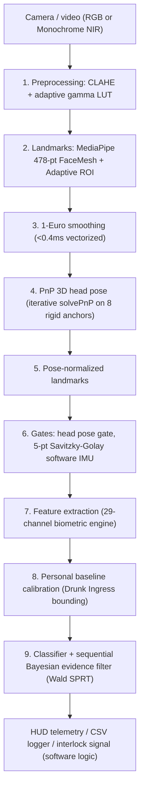

# The Overclocked: Driver Monitoring System (DMS)

[](https://www.python.org/)
[]()
[](https://opensource.org/licenses/MIT)

A research prototype that measures eyelid, eye, gaze, and head movements from a driver-facing camera (RGB webcam or monochrome NIR) and investigates whether those measurements can support passive impairment detection for a vehicle interlock.

> **Status: Proof of concept. Not clinically validated.**
> No model in this repository has been validated against measured blood alcohol concentration (BAC), and nothing here should be described as a certified intoxication detector. Every threshold marked `[PLACEHOLDER]` is an untuned design target pending empirical calibration against real impairment datasets (such as Toyota IDD). The system has never been tested in an operating vehicle. Safety architecture is ASIL-inspired and **not certified** under ISO 26262.

---

## Project status

| Component | State |
| :--- | :--- |
| **Perception pipeline** (preprocessing, landmarks, smoothing, pose normalization, gating, feature extraction) | **Implemented.** 155 automated unit and integration tests passing (`pytest tests/ -v`). |
| **Gaze features** (iris tracking, saccades, GEN, binocular vergence, VOR) | **Implemented.** Conjugate horizontal frame axis mapping (`[-1, 1]`) and bilateral symmetry verified. Degree-per-unit scaling in `config.py` is a placeholder. |
| **Forehead & Full Cheeks Coverage** | **Implemented.** Full 27-landmark forehead contour loop + 20-point frontal patch and 44-point cheek matrices (22 per side) with 9-vertex closed perimeter outlines for T-zone tracking and HUD visualization. |
| **Rule-based classifier, personal baseline calibration, Bayesian filter** | **Implemented.** Thresholds are design targets marked `[PLACEHOLDER]`. Not clinically validated. |
| **Trained models** | Synthetic baseline model (`models/baseline_impairment_model.joblib`) provided as a pipeline proof of concept only (see Data). |
| **Vehicle interlock** (starter lockout, throttle attenuation) | **Design & logic only.** Software outputs interlock and latching signals; physical relays/actuators not built. |
| **Breath-sensor fusion** | Not implemented. |
| **Real-vehicle testing** | None. |

## What this project can and cannot claim

- **Can claim:** A modular, reproducible edge measurement pipeline with comprehensive regression tests (155 passing), real-time CPU performance, and a disciplined engineering framework for evaluating physiological impairment signals.
- **Cannot claim:** That it detects intoxication in production, that any listed biomarker is "unfakeable," or that it meets automotive functional safety certification. ISO 26262 compliance requires rigorous process audits, formal Hazard Analysis and Risk Assessment (HARA), and safety-qualified tooling, not just unit tests.
- **Regulatory context:** Published camera-based studies detect impairment from roughly 0.05% BAC upward. India's legal limit is 0.03%, so a passive vision system alone cannot be expected to reliably catch a driver right at the threshold without secondary sensor confirmation.

---

## Architecture

The system executes a modular, synchronized pipeline where raw camera frames pass through strictly ordered perception, normalization, and filtering stages:



### Vibration and lighting handling

1. **Lighting normalization:** Contrast Limited Adaptive Histogram Equalization (CLAHE, $8 \times 8$ grid, clip limit 2.0) combined with precomputed 256-entry lookup tables (LUT) for adaptive gamma correction on dark and dim frames (`pipeline/preprocessing.py`).
2. **Landmark jitter:** Vectorized 1-Euro adaptive low-pass filter (Casiez et al., CHI 2012) operating across all 478 landmarks simultaneously in $<0.4\text{ ms}$ before pose solving (`pipeline/one_euro_filter.py`).
3. **Rigid head normalization:** Robust Perspective-n-Point (`cv2.solvePnP` with `SOLVEPNP_ITERATIVE` and temporal extrinsic guess reuse) against an expanded 8-point canonical face model (`CANONICAL_FACE_3D_8` adding nose bridge 168 and glabella 9). Eliminates vehicle bounce by computing internal facial metrics relative to the head frame (`pipeline/pnp_normalizer.py`).
4. **Head pose gate:** Features freeze with holdover (`HOLD_LAST`) when $|\text{yaw}| > 35^\circ$, $\text{pitch} < -30^\circ$, or $\text{pitch} > 25^\circ$ (`pipeline/head_pose_estimator.py`). `[PLACEHOLDER]`
5. **Software shock gate:** 5-point non-uniform Savitzky-Golay quadratic fit computing 3D nose-tip acceleration, decoupled from rotational motion ($\dot{\theta} < 20^\circ/\text{s}$). Freezes features for 150 ms if linear acceleration exceeds $2.5\text{ m/s}^2$ (`pipeline/imu_gate.py`). `[PLACEHOLDER]`
6. **Motor event detection:** Saccades use dual-velocity hysteresis ($30^\circ/\text{s}$ onset, $15^\circ/\text{s}$ offset). Blinks use a 4-state Finite State Machine (`open` $\to$ `closing` $\to$ `closed` $\to$ `opening`).
7. **Distant drivers:** An `AdaptiveROITracker` (`pipeline/face_mesh_detector.py`) with EMA temporal smoothing ($\alpha=0.35$) crops an expanded $2.0\times$ square bounding box directly from the raw frame, boosting effective face resolution $\sim 8\times$ inside the detector. When lost, it evaluates a Central Driver Quadrant crop ($[0.2W, 0.1H]$ to $[0.8W, 0.85H]$).
8. **Monochrome NIR invariance:** Auto-detects single-channel or monochrome 940nm NIR video. Automatically bypasses visible-spectrum chromaticity calculations (sclera redness, facial flushing) and reallocates diagnostic weights across structural markers in `pipeline/classifier.py`.

### Timing

Velocities and derivatives use real frame timestamps (`timestamp` in seconds), including dynamic $\Delta t$ handling for dropped frames and variable frame rates. Features are never calculated assuming an unvarying frame interval.

---

## Landmark conventions

- **Subject's Left Eye** (viewer's right in an unmirrored camera stream):
  - Iris center: **468**; Iris ring: `[469, 470, 471, 472]`
  - Outer temporal canthus: **263**; Inner nasal canthus: **362**
- **Subject's Right Eye** (viewer's left in an unmirrored camera stream):
  - Iris center: **473**; Iris ring: `[474, 475, 476, 477]`
  - Outer temporal canthus: **33**; Inner nasal canthus: **133**
- **Conjugate horizontal gaze:** Gaze $X \in [-1, 1]$ is aligned to a consistent camera frame axis (+X toward image right for both eyes), preventing polarity mismatch and false Lack of Convergence (LOC) triggers during conjugate saccades.
- **EAR point sets:**
  - Right eye: `[33, 160, 158, 133, 153, 144]` (P1=33, P2=160, P3=158, P4=133, P5=153, P6=144)
  - Left eye: `[263, 385, 387, 362, 373, 380]` (P1=263, P2=385, P3=387, P4=362, P5=373, P6=380)
- **Forehead region:** 27-landmark continuous closed contour loop (`FOREHEAD_CONTOUR`, $143\text{ px} \times 58.5\text{ px}$) spanning the hairline arc (`127 -> 10 -> 356`) and supraorbital brow arch (`356 -> 9 -> 127`), plus 20 frontal bone interior landmarks (`FOREHEAD_PATCH`).
- **Full cheek regions:** 22 anatomical landmarks per side (44 total, `FULL_RIGHT_CHEEK` and `FULL_LEFT_CHEEK`) covering the infraorbital margin, malar apple, zygomatic arch, and lower buccal area, enclosed by smooth 9-vertex closed perimeter contours (`RIGHT_CHEEK_OUTLINE`, `LEFT_CHEEK_OUTLINE`).
- **T-zone vasodilation tracking:** 64 landmarks (`VASODILATION_LANDMARKS = FULL_CHEEK_LANDMARKS + FOREHEAD_PATCH`).

---

## Features

The training buffer (`pipeline/training_buffer.py`) records **29 channels** (22 continuous signals and 7 discrete flags). Gating flags (`imu_gated`, `gating_reason`) act strictly as **validity masks** and are excluded from model inputs.

| Group | Signals |
| :--- | :--- |
| **Eyelid kinetics** | EAR (left, right, mean), blink closing velocity, blink opening velocity, PERCLOS (O(1) ring counter), microsleep detected flag, blink detected flag |
| **Gaze dynamics** | Iris x/y per eye, saccade angular velocity, saccade latency (reaction time proxy), gaze yaw dispersion ($\sigma_{\text{yaw}}$), saccade detected flag |
| **Advanced oculomotor** | Gaze-Evoked Nystagmus (slow-phase drift velocity, beat count, GEN flag), smooth pursuit fragmentation ratio, binocular vergence angle, Lack of Convergence (LOC flag), Vestibulo-Ocular Reflex (VOR gain) |
| **Mouth & head pose** | MAR (dense 3-pair formula), yawn detected flag, head yaw, head pitch, head roll |
| **Corroborating physiological** | Seated head postural sway ($\sqrt{\sigma_{\text{pitch}}^2 + \sigma_{\text{roll}}^2}$, 0% lockout authority), facial flushing chromaticity ratio ($R / \frac{G+B}{2}$) and delta across full cheeks and forehead T-zone (RGB only, bypassed under NIR), conjunctival sclera redness (RGB only) |

### Section A vs. Section B biomarker split

* **Section A — Involuntary Reflexes (Primary diagnostic authority):**
  Includes Gaze-Evoked Nystagmus (GEN), smooth pursuit breakdown, VOR micro-gain depression, binocular strabismus/LOC, involuntary blink reopening speed ($v_{\text{up}}$), cerebellar postural sway, and T-zone micro-vascular flushing. These signals reflect subcortical, brainstem, or autonomic motor control that is difficult to consciously sustain or suppress.
* **Section B — Voluntary & Semi-Voluntary Behaviors (Masking & Gaming indicators):**
  Includes deliberate blink suppression (prolonged inter-blink intervals $> 6.0\text{s}$), voluntary eye-widening spikes (frontalis/levator surges $> 1.25\times \text{baseline}$ following droop episodes), compensatory central staring fixation ($> 6.0\text{s}$, $\sigma_{\text{gaze}} < 0.8^\circ$), and rigid cervical neck stabilization.
* **Anti-Masking Divergence Metric ($M_{\text{mask}}$):**
  Quantifies discordance when a driver consciously forces eyelid or postural control while involuntary neurological reflexes deteriorate. When kinetic discordance exceeds $50.0\%$ (`masking_detected = True`), an anti-masking alert is logged. `[PLACEHOLDER]`

---

## Decision logic

- **Personal baseline calibration (`pipeline/calibration.py`):** Driver-specific baselines (awake EAR, resting MAR, blink upstroke speed, facial chromaticity, asymmetry, resting posture) are accumulated over the initial 30–60 seconds of driving.
- **Drunk Ingress protection:** Calibrator enforces physiological sanity bounds:
  - $\text{EAR} \in [0.25, 0.38]$ (median sober ~0.28)
  - $v_{\text{up}} \in [1.80, 3.20]\text{ EAR/s}$ (median sober ~2.50 EAR/s)
  - $\text{Asymmetry} \le 0.05$
  If an impaired driver enters with ptosis or sluggish kinetics, `ingress_impairment_detected = True` locks baselines to conservative population norms and triggers an ingress risk flag. `[PLACEHOLDER]`
- **Sequential Bayesian evidence filter (`pipeline/bayesian_filter.py`):** Implements Wald's Sequential Probability Ratio Test (SPRT). Updates log-odds using likelihood ratios derived from Section A involuntary signals. Features an anti-chattering leaky decay ($-2.0 \cdot dt$) to absorb transient optical noise without resetting evidence to zero. Arming a lockout interlock requires $P \ge 0.999$ sustained continuously for $\ge 15.0\text{s}$, entering a latched state that clears only upon confirmation of vehicle park gear. `[PLACEHOLDER]`
- **Telemetry wording:** System outputs report an *impairment-pattern score (unvalidated)*, never a medical or legal diagnosis.

---

## Data and training policy

| Source | Description | Use in Pipeline |
| :--- | :--- | :--- |
| **Toyota IDD** (Impaired Driving Dataset) | Driving simulator study (52 drivers, 0.10% BAC and distraction conditions) with gaze and video records. | Ingestion engine implemented in `idd_ingest.py`. **Confound note:** Sober trials occurred in Block 1 and alcohol in Block 2, introducing elapsed-time correlation. Single BAC level (0.10%); unvalidated for 0.03% or 0.05%. |
| **DIF** (Drunk Impaired Face) | Uncurated public video clips. | Unreliable annotations and uncalibrated recording conditions. Not used for validated results. |
| **Planned sober recordings** | Consenting participants under controlled settings. | Measurement noise floor evaluation, glasses glare testing, and personal baseline stability. |

### Model training rules
- Strict subject-independent cross-validation (`GroupKFold` on `subject_id` in `train_baseline.py`) to prevent cross-subject data leakage.
- Extract 7 statistical summaries per window across all 29 channels ($29 \times 7 = 203\text{ features}$).
- Evaluate using ROC-AUC, PR-AUC, Sensitivity, Specificity, and F1-score; never reporting raw accuracy alone.
- Keep raw videos, personal frames, and trained artifact binaries out of git.

---

## Known limitations

- **Resolution and optical quantization:** Standard desktop webcams ($640 \times 480$ or $1280 \times 720$) provide coarse iris resolution. At $1.5\text{ meters}$, $1^\circ$ of gaze shift corresponds to approximately $0.25\text{--}0.5\text{ pixels}$. Fine nystagmus drift and micro-saccades approach the camera noise floor.
- **Frame rate quantization:** At 30 fps, a typical 60–100ms blink downstroke spans only 2–3 frames. Production automotive oculomotor measurement requires $\ge 60\text{--}120\text{ fps}$ global-shutter NIR hardware.
- **Degree mapping scaling:** The angular scaling parameter (`_DEG_PER_IRIS_UNIT = 50.0`) is an uncalibrated design placeholder.
- **Rolling shutter distortion:** Standard consumer webcams distort rapid head movements; production DMS demands global-shutter sensors.
- **Monocular PnP:** Uses a single generic 3D canonical face model, introducing subject-specific scale approximation.

---

## Installation & usage

Compatible with Python 3.9 through 3.14 on Windows, Linux, and macOS.

```bash
# Clone the repository
git clone https://github.com/Thanos3541R/The_Overclocked.git
cd The_Overclocked

# Install dependencies
pip install -r requirements.txt
```

### 1. Live Camera Feed with Color-Coded HUD
```bash
# Launch default camera (RGB or NIR)
python main.py

# Run on recorded video with CSV feature export
python main.py --source /path/to/video.mp4 --save-csv --csv-path features.csv

# Launch with overlay disabled (hotkey [v] cycles: off -> key regions -> full mesh)
python main.py --no-mesh
```

### 2. Forensic Video Feature Extraction & Anti-Masking Report
```bash
python extract_video_features.py --video /path/to/video.mp4 --output-dir ./report_output/
```
Generates 3 forensic artifacts:
- `video_features_report.txt`: Detailed clinical and lockout audit report separating Section A and Section B.
- `video_features.csv`: Full time-series CSV of all 29 frame-by-frame signals.
- `video_features_summary.json`: Machine-readable summary metrics and ML risk payload.

### 3. Static Image & Video Diagnostic Inspection
```bash
python inspect_driver.py --image path/to/photo.jpg
python inspect_driver.py --capture
python inspect_driver.py --video path/to/driving_clip.mp4
```

### 4. Dataset Ingestion & Model Training
```bash
# Ingest Toyota IDD video dataset into windowed .npz tensors
python idd_ingest.py --idd-root /path/to/idd --output-dir ./idd_output/

# Run baseline training benchmark with GroupKFold cross-validation
python train_baseline.py --test-synthetic

# Train on ingested dataset archives
python train_baseline.py --data-dir ./idd_output/ --output-model models/trained_model.joblib
```

### 5. Run Automated Test Suite
```bash
pytest tests/ -v
```
All **155 unit, geometric, invariance, and integration tests** execute in $\approx 30\text{ seconds}$ with a 100% pass rate.

---

## Repository structure

```
driver-monitor/
├── config.py                 # Central configuration dataclass; thresholds marked [PLACEHOLDER]
├── main.py                   # Real-time application with color-coded HUD and CSV logging
├── inspect_driver.py         # Diagnostic tool for single-image, live capture, or video inspection
├── export_feature_output.py  # Feature extraction export tool (TXT, JSON, CSV)
├── extract_video_features.py # Batch video analyzer with Section A/B report generation
├── idd_ingest.py             # Batch ingestion engine for Toyota IDD driving dataset
├── train_baseline.py         # ML training pipeline with GroupKFold & 203 window features
├── requirements.txt          # Python package dependencies
├── models/
│   ├── face_landmarker.task  # MediaPipe 478-point landmark bundle (auto-downloads if absent)
│   ├── baseline_impairment_model.joblib # Baseline classifier artifact (demonstration only)
│   └── training_report.json  # Cross-validation performance report
├── pipeline/
│   ├── frame_capture.py       # Polymorphic camera/video reader (DirectShow, MJPG, RGB & NIR)
│   ├── preprocessing.py       # CLAHE & adaptive Gamma LUT low-light enhancer
│   ├── face_mesh_detector.py  # MediaPipe Face Mesh detector with AdaptiveROITracker & Multi-Scale Zoom
│   ├── one_euro_filter.py     # Vectorized temporal low-pass filter (<0.4ms)
│   ├── pnp_normalizer.py      # Robust solvePnP pose estimation & rigid metric normalization
│   ├── head_pose_estimator.py # Head pose gating & tracking
│   ├── imu_gate.py            # 5-point Savitzky-Golay quadratic IMU shock gate
│   ├── feature_extractor.py   # 29-signal physiological feature extraction engine
│   ├── calibration.py         # Personal baseline calibrator with Drunk Ingress bounding
│   ├── classifier.py          # Impairment diagnostic classifier (with NIR weight redistribution)
│   ├── bayesian_filter.py     # Sequential Bayesian evidence accumulator with Wald SPRT
│   └── training_buffer.py     # 29-channel windowed numpy tensor generator for ML models
├── utils/
│   ├── landmarks.py           # Canonical 3D models, MediaPipe constants, forehead & full cheek indices
│   ├── overlay_regions.py     # 9 color-coded HUD overlay regions with vectorized batch drawing
│   └── visualization.py       # OpenCV HUD telemetry display & region legend
└── tests/
    ├── sample_driver_video.mp4 # Video fixture for regression & invariance benchmarking
    └── test_*.py              # 16 test modules (155 automated unit & integration tests)
```

---

## Ethics and privacy

Camera streams contain facial biometric data. The software processes images strictly in volatile local memory, persists no raw frames unless explicitly requested by CLI arguments, and requires informed consent before recording. Deployment in India must adhere to the Digital Personal Data Protection Act (DPDPA), 2023, ensuring transparent purpose limitation, data minimization, and user rights.

---

## License

This project is licensed under the [MIT License](LICENSE).
