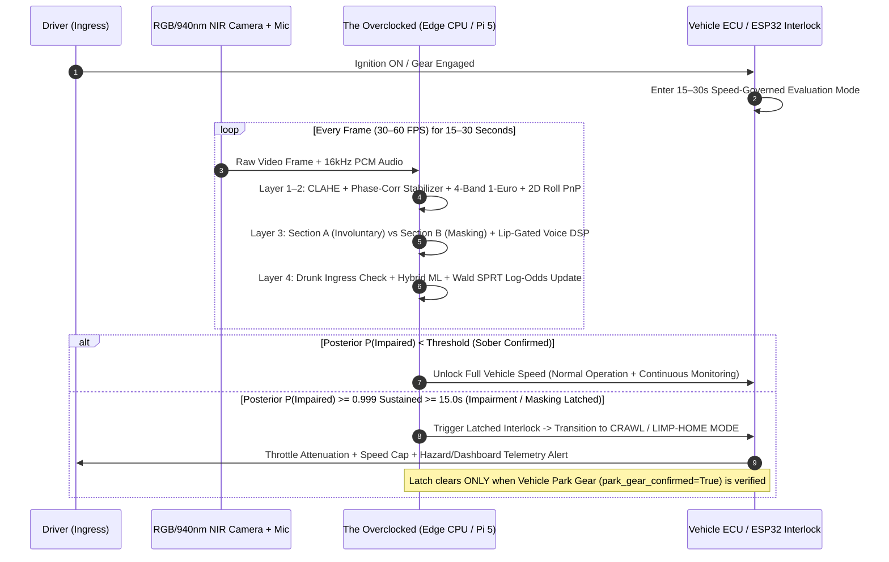
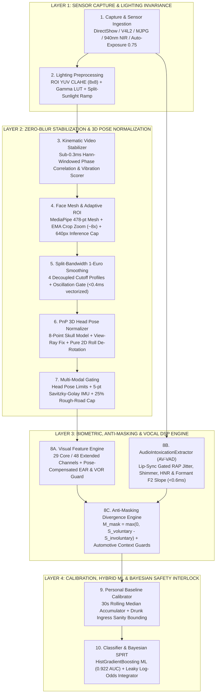
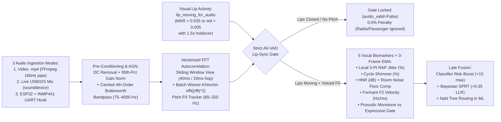

# The Overclocked: Oculomotor, Postural & Vocal Driver Monitoring System (DMS)

[](https://www.python.org/)
[-brightgreen.svg)](#15-verification--automated-test-suite-314-tests)
[-00b4d8.svg)](#8-hybrid-ml-classifier--wald-sprt-sequential-bayesian-filter)
[-9b5de5.svg)](#6-audio-visual-voice-intoxication-dsp-engine-pipelineaudio_extractorpy)
[](#3-4-layer-subsystem-deep-dive--module-map)
[](https://opensource.org/licenses/MIT)

**The Overclocked** is a real-time, edge-optimized **Oculomotor, Postural, and Vocal Driver Monitoring System (DMS)** built in Python (OpenCV, MediaPipe Face Mesh 478-point + 10-iris topology, NumPy/SciPy DSP, and Scikit-Learn). It passively measures **strictly involuntary subcortical, brainstem, and autonomic micromotions** alongside **lip-gated vocal-tract acoustics** from a single driver-facing camera (RGB or 940nm Near-Infrared) and cabin microphone to detect alcohol intoxication and severe fatigue within a **15–30 second speed-governed ingress evaluation window**.

> **🤖 AI & Teammate Context Notice:**  
> This `README.md` serves as the **Single Source of Truth (SSOT)** for teammates and AI coding assistants (Google Antigravity, Gemini, Claude, Cursor). It documents the complete 4-layer architecture, all 48 visual + 7 acoustic telemetry channels, the 10-phase cabin vibration hardening pipeline, the granular geometric/pose guards, the Audio-Visual Voice Activity Gated (AV-VAD) acoustic engine, the Anti-Masking Divergence engine (`M_mask`), the Wald SPRT Bayesian safety filter, the TRIZ engineering matrix, and the Raspberry Pi 5 + ESP32 Hardware-in-the-Loop (HIL) deployment topology.

> **⚠️ Regulatory & Clinical Candor Disclaimer:**  
> This system is an **edge AI measurement and research framework**, not a clinically certified medical device or ISO 26262 certified production safety unit. While the ML model is cross-validated across 9,460 temporal windows (337 subjects), heuristic rule cutoffs represent physiological design targets. Camera-based oculomotor tracking reliably resolves impairment from `~0.05% BAC` upward; catching impairment down to India's strict `0.03% BAC` legal limit requires secondary multi-modal corroboration (vocal dysarthria + smart seatbelt/breath sensors).

---

## Table of Contents
1. [Operational Concept: 15–30s Speed-Governed Window & Crawl Mode](#1-operational-concept-1530s-speed-governed-window--crawl-mode)
2. [System Architecture & 10-Stage Execution Pipeline](#2-system-architecture--10-stage-execution-pipeline)
3. [4-Layer Subsystem Deep Dive & Module Map](#3-4-layer-subsystem-deep-dive--module-map)
4. [Granular Perception, Smoothing & Geometric Hardening Specs](#4-granular-perception-smoothing--geometric-hardening-specs)
5. [Biometric Feature Engine: Section A (Involuntary) vs. Section B (Masking)](#5-biometric-feature-engine-section-a-involuntary-vs-section-b-masking)
6. [Audio-Visual Voice Intoxication DSP Engine (`pipeline/audio_extractor.py`)](#6-audio-visual-voice-intoxication-dsp-engine-pipelineaudio_extractorpy)
7. [Personal Baseline Calibration & Drunk Ingress Protection](#7-personal-baseline-calibration--drunk-ingress-protection)
8. [Hybrid ML Classifier & Wald SPRT Sequential Bayesian Filter](#8-hybrid-ml-classifier--wald-sprt-sequential-bayesian-filter)
9. [Tri-Modal Fusion & 4-Tier Impairment Severity Grading](#9-tri-modal-fusion--4-tier-impairment-severity-grading)
10. [TRIZ Engineering Contradiction Matrix & Separation Principles](#10-triz-engineering-contradiction-matrix--separation-principles)
11. [Project Evolution Roadmap & Dataset Cleaning Pipeline](#11-project-evolution-roadmap--dataset-cleaning-pipeline)
12. [Hardware-in-the-Loop (HIL) Edge Deployment (Raspberry Pi 5 + ESP32)](#12-hardware-in-the-loop-hil-edge-deployment-raspberry-pi-5--esp32)
13. [Installation, CLI Quick Start & Live HUD Controls](#13-installation-cli-quick-start--live-hud-controls)
14. [Repository Directory Structure & AI Context Index](#14-repository-directory-structure--ai-context-index)
15. [Verification & Automated Test Suite (314+ Tests)](#15-verification--automated-test-suite-314-tests)
16. [Ethics, Biometric Privacy & DPDPA Compliance](#16-ethics-biometric-privacy--dpdpa-compliance)

---

## 1. Operational Concept: 15–30s Speed-Governed Window & Crawl Mode

Traditional alcohol interlocks either force drivers to blow into a tube on every trip or risk stalling a moving vehicle on a false alarm. **The Overclocked** resolves this via a **Non-Intrusive Speed-Governed Ingress Window**:



### Core Operational Principles
1. **Strictly Involuntary Micromotion Authority:** Detection authority relies on brainstem, cerebellar, and autonomic reflexes (levator palpebrae upstroke speed `v_up`, saccadic velocity-amplitude main sequence, central fixation micro-drift, binocular vergence loss, and vocal cord RAP jitter / formant `F2` slurring) that an intoxicated driver physically cannot suppress or fake.
2. **Zero Mid-Drive Engine Stall Hazard:** Instead of cutting engine power in moving traffic, confirmed intoxication transitions the vehicle into **Crawl / Limp-Home Mode** (governed low speed + throttle attenuation + hazard indicators) until safely parked.

---

## 2. System Architecture & 10-Stage Execution Pipeline



---

## 3. 4-Layer Subsystem Deep Dive & Module Map

| Layer | Module File | Core Responsibility & Algorithmic Implementation | Latency / Benchmark |
| :--- | :--- | :--- | :--- |
| **Layer 1** | `pipeline/frame_capture.py` | Lock-free daemon thread reader (`CAP_PROP_BUFFERSIZE=1`, `CAP_PROP_AUTO_EXPOSURE=0.75`, MJPG negotiation); auto-detects RGB vs. monochrome 940nm NIR frames. | `< 0.2 ms` queue read |
| **Layer 1** | `pipeline/preprocessing.py` | Face-ROI localized YUV luminance CLAHE (`8x8` grid, clip `2.0`), precomputed 256-entry Gamma LUTs (`gamma=0.5` dark, `gamma=0.7` dim), bilateral split-sunlight ramp balancing, and bright-scene blend (`35%` CLAHE / `65%` raw `Y` when luminance `>= 95`) to prevent eyeglass glare blowout. | `~1.5 ms` / frame |
| **Layer 2** | `pipeline/stabilizer.py` | **Zero-Blur Kinematic Stabilizer:** Cached Hann-windowed 2D FFT Phase Correlation (`cv2.phaseCorrelate`) restricted to the face ROI; outputs sub-pixel shift `(dx, dy)`, high-frequency jitter, and `3–15 Hz` `vibration_score` without blurring pixels. | `< 0.3 ms` / frame |
| **Layer 2** | `pipeline/face_mesh_detector.py` | MediaPipe `FaceLandmarker` in `RunningMode.VIDEO` with `AdaptiveROITracker` (`2.0x` crop margin, `~8x` effective spatial resolution boost, `640px` inference cap, anatomical topology validation, and throttled no-face recovery). | `~12–18 ms` (CPU) |
| **Layer 2** | `pipeline/one_euro_filter.py` | **4-Bandwidth Vectorized 1-Euro Filter:** Splits smoothing across rigid skull (`0.7 Hz`), eyelids (`2.0 Hz`, `beta=0.50`), irises (`1.5 Hz`, `beta=0.55`), and synchronized eye corners (`1.5 Hz`, `beta=0.35`) with IOD normalization and sign-reversal oscillation damping. | `< 0.4 ms` / frame |
| **Layer 2** | `pipeline/pnp_normalizer.py` | 8-point skull-bound `cv2.solvePnP` (`SOLVEPNP_ITERATIVE` + extrinsic guess reuse + `SQPNP`/`EPNP` fallbacks), view-ray perspective angle compensation, mirror `±42°` yaw bifurcation suppression, and **pure 2D in-plane inter-canthal roll de-rotation**. | `~1.2 ms` / frame |
| **Layer 2** | `pipeline/head_pose_estimator.py`<br>`pipeline/imu_gate.py` | Freezes feature extraction (`HOLD_LAST`) on extreme head turns (`|yaw| > 35°`, `pitch not in [-30°, +25°]`) or transient pothole shocks (`> 4.0 m/s²` for `150 ms`) via a 5-point Savitzky-Golay quadratic polynomial fit decoupled from voluntary nods (`rot_vel < 20°/s`). Enforces a **25% max freeze duty-cycle cap** on rough roads. | `< 0.2 ms` / frame |
| **Layer 3** | `pipeline/feature_extractor.py` | Thread-safe (`threading.RLock`) 48-channel visual biometric engine: pose-compensated 6-pt EAR, 3-pt OLS blink velocity (`v_up`), `O(1)` ring-buffer PERCLOS, 5-pt iris centroid gaze, saccade kinematics, GEN nystagmus FSM, smooth pursuit fragmentation, binocular vergence (LOC), VOR gain, postural sway, rPPG pulse/HRV, and Section B anti-masking metrics. | `~1.8 ms` / frame |
| **Layer 3** | `pipeline/audio_extractor.py` | **Audio-Visual Voice Activity Gated (AV-VAD) Acoustic Engine:** Vectorized Wiener-Khinchin FFT autocorrelation & spectral DSP extracting **Local 3-Frame RAP Vocal Jitter (%)**, **Vocal Shimmer (%)**, **Harmonics-to-Noise Ratio (HNR dB)**, **Formant `F2` Slurring Velocity (`Hz/ms`)**, and **Speech Pause Ratio** with 3-frame EMA smoothing. | `< 0.6 ms` / window |
| **Layer 4** | `pipeline/calibration.py` | 30-second rolling median `PersonalBaselineCalibrator` with off-axis camera mounting zero-tare and **Drunk Ingress Protection** (clamping baseline `EAR in [0.25, 0.38]`, `v_up in [1.80, 3.20] EAR/s`, `Asymmetry <= 0.05`). | `< 0.1 ms` / frame |
| **Layer 4** | `pipeline/classifier.py`<br>`pipeline/bayesian_filter.py` | Hybrid rule-based + calibrated `HistGradientBoostingClassifier` ML inference with NIR chromaticity weight redistribution, catatonic stupor override, secondary voice corroboration, and **Wald's SPRT Sequential Bayesian Filter** (`lambda = 2.0` leaky decay, `P >= 0.999` for `>= 15.0 s`). | `< 0.5 ms` / frame |
| **Layer 4** | `utils/visualization.py`<br>`utils/overlay_regions.py` | Vectorized `cv2.polylines` HUD renderer with 9 anatomical color-coded regions, top-center diagnostic banner, ROI/stabilizer shift vector display, live voice readout, and interactive hotkeys. | `< 0.85 ms` / frame |

---

## 4. Granular Perception, Smoothing & Geometric Hardening Specs

### 4.1 High-Speed Capture & Adaptive ROI (`pipeline/frame_capture.py` & `pipeline/face_mesh_detector.py`)
* **Hardware Exposure & Buffer Control:** Configures `CAP_PROP_BUFFERSIZE = 1` and `CAP_PROP_AUTO_EXPOSURE = 0.75` (with fallback to `0.25`) to minimize sensor motion blur during rapid head movement and saccades.
* **Inference Downscaling Cap (`640px`):** Large ROI crops (`> 640px`) are downscaled prior to MediaPipe neural network inference and remapped back to full-frame sub-pixel coordinates with exact linear scaling.
* **Anatomical Topology & Scale-Collapse Validation:** Rejects distorted or folded meshes via bounding-box aspect ratio bounds (`0.38 <= aspect <= 2.50`), inter-ocular width (`dx > 5.0 px`, `iod >= 0.18 * bw`), vertical anatomical ordering (nose tip strictly between eye line and mouth line along the face tilt vector), and single-frame scale bounds (`0.55 <= scale / prev_scale <= 1.80`).
* **Throttled No-Face Recovery:** When full-frame `VIDEO` mode detects no face, heavy `IMAGE`-mode fallbacks are throttled to initial acquisition and every 5th lost frame, slashing no-face latency from `~100 ms` down to `~12 ms`.
* **Idempotent Graph Teardown:** Ensures `close()` is idempotent and safely clears C++ handles to prevent double-destruction crashes during Python garbage collection and interpreter exit.

### 4.2 4-Bandwidth 1-Euro Smoothing with Synchronized Eye Corners (`pipeline/one_euro_filter.py`)
* **Adaptive Cutoff Law:** For each landmark coordinate, the cutoff frequency adapts dynamically with movement speed:
  $$f_c = f_{c,\min} + \beta_{\text{eff}} \cdot |\hat{\dot{x}}|, \quad \alpha = \frac{2\pi f_c \Delta t}{2\pi f_c \Delta t + 1}$$
* **4-Bandwidth Vectorized Profiles:** Separates smoothing profiles across four distinct anatomical groups in a single vectorized NumPy step (`< 0.4 ms`):
  1. **Rigid Skull / Structural Landmarks (440 pts):** `min_cutoff = 0.7 Hz`, `beta = 0.007` (stabilizes 3D PnP pose).
  2. **Eyelid Margins (8 pts):** `min_cutoff = 2.0 Hz`, `beta = 0.50`, `d_cutoff = 8.0 Hz` (preserves fast `50–100 ms` blink kinematics).
  3. **Iris Landmarks (10 pts):** `min_cutoff = 1.5 Hz`, `beta = 0.55`, `d_cutoff = 4.0 Hz` (tracks single-frame saccadic darts without attenuation).
  4. **Eye Canthi Corners (`[33, 133, 263, 362]`):** `min_cutoff = 1.5 Hz`, `beta = 0.35`, `d_cutoff = 4.0 Hz`.
* **Eye Corner Lag Elimination:** Synchronizing the 4 eye canthi anchors with the eyelid and skull filters guarantees that horizontal eye corners move in lockstep with vertical eyelids during rapid head turns and scale adjustments, preventing horizontal corner lag from artificially inflating EAR (`> 0.45`).
* **Oscillation Sign-Reversal Damping:** Tracks frame-to-frame derivative sign reversals (`dx * raw_dx_prev < 0`). Under `3–15 Hz` cabin vibration (`oscillation_rate > 0.38`), `beta_eff` is damped by up to `95%` so chassis shake is rejected while unidirectional blinks pass through cleanly.

### 4.3 Saccade Dynamics, Occlusion Guard & VOR Suppression (`pipeline/feature_extractor.py`)
* **Blink & Eyelid-Motion Occlusion Guard:** Whenever eyelids enter `closing`, `closed`, or `opening` phases, iris tracking holds over and re-anchors `_prev_iris_x` and `_prev_iris_y` upon reopening, preventing eyelid occlusion from masquerading as a `500°/s` saccade.
* **Physical 2D Socket Translation Guard:** Distinguishes genuine head motion from stationary PnP Euler jitter. Vestibulo-Ocular Reflex (VOR) counter-rotation compensation requires physical 2D eye-socket translation (`eye_socket_vel > 0.75` or `eye_socket_vel > 0.25` when `head_vel_deg_s > 30.0°/s`), preventing stationary gaze saccades from being falsely suppressed.
* **Conjugate Binocular Validation:** Checks binocular direction agreement (`dx_l * dx_r < -1e-4` zeroes out monocular eyeglass reflections) while using bilateral displacement scaled at `_SACCADE_DEG_PER_UNIT = 22.0°/unit` to resolve real eye darts under unilateral perspective compression.

### 4.4 Pose-Compensated EAR & Bilateral Blink Verification (`pipeline/feature_extractor.py`)
* **Unilateral Foreshortening Guard:** When `|head_yaw| > 10°`, one eye is wide open (`>= max(0.26, eff_blink_threshold * 1.30)`), and there is severe inter-ocular asymmetry (`|ear_left - ear_right| > 0.09`), perspective compression on the far eye is guarded against triggering false blinks while `100%` of genuine bilateral blinks are preserved.
* **Blink FSM Un-foreshortened EAR Injection:** During head turns, the un-foreshortened dominant eye EAR is fed into `_compute_blink_velocity()` to prevent the 4-state blink machine (`open -> closing -> closed -> opening`) from entering false `closing` or `closed` phases.

### 4.5 10-Phase Automotive Cabin & Context Guard Summary
```text
┌─────────────────────────────────────────────────────────────────────────────────────┐
│                 10-PHASE AUTOMOTIVE CABIN & VIBRATION HARDENING                     │
├──────────────────────────────────────────┬──────────────────────────────────────────┤
│ VIBRATION & OPTICAL STABILIZATION (1–5)  │ REAL-WORLD DRIVING CONTEXT GUARDS (6–10) │
├──────────────────────────────────────────┼──────────────────────────────────────────┤
│ 1. Oscillation-Gated 1-Euro Filter:      │ 6. Pitch-Compensated EAR (Speedometer):  │
│    Detects velocity sign reversals       │    Downward dashboard glances do not     │
│    (dx * raw_dx_prev < 0), scales by IOD,│    trigger false eyelid ptosis alerts.   │
│    and cuts beta by 95% under vibration. │                                          │
│ 2. Sub-Pixel Hann ROI Phase Correlation: │ 7. Highway Fixation Exemption:           │
│    Tracks face-box shift (dx, dy) with   │    Long attentive road stares are exempt │
│    0.25px sensitivity, ignoring traffic. │    if prior blink v_up >= 1.80 EAR/s.    │
│ 3. Pure 2D In-Plane Roll Normalization:  │ 8. Optokinetic (OKN) vs Pathological GEN:│
│    De-rotates via eye-corner angle θ_roll│    Separates natural passing-scenery     │
│    so 3D PnP Z-chatter never warps EAR.  │    reflexes from alcohol GEN drift.      │
│ 4. 5-Pt Iris Centroid & 3-Pt OLS Blink:  │ 9. Speech Cadence & AV-VAD Lip Gate:     │
│    Reduces iris jitter by √5 (2.23x) and │    1.5–3.0Hz lip oscillation + mic pitch │
│    tolerates 1-frame vibration glitches. │    suppresses false yawns & radio noise. │
│ 5. Rough-Road 25% Freeze Duty-Cycle Cap: │ 10. Monocular Eyeglass Glare Fallback:   │
│    Potholes (>4m/s²) freeze 150ms; rough │    If one lens has >245 specular glare,  │
│    roads (>500ms) switch to heavy damping│    EAR falls back to the unoccluded eye. │
└──────────────────────────────────────────┴──────────────────────────────────────────┘
```

---

## 5. Biometric Feature Engine: Section A (Involuntary) vs. Section B (Masking)

Impaired drivers often attempt to "game" vision monitors by forcing their eyes wide open, lifting their eyebrows, or stiffening their neck. Our feature engine (`pipeline/feature_extractor.py` & `pipeline/training_buffer.py`) provides dual-mode extraction (**29 Core Channels** or **48 Extended Visual Channels** + **7 Audio Channels**), separating **unfakeable subcortical reflexes (Section A)** from **conscious cortical compensation (Section B)**:

```text
┌───────────────────────────────────────────────────────────────────────────────────┐
│                    SECTION A: INVOLUNTARY SUBCORTICAL BIOMARKERS                  │
│          (Brainstem, Cerebellar & Autonomic — Primary Lockout Authority)          │
├─────────────────────────────────────────┬─────────────────────────────────────────┤
│ • Blink Upstroke Speed v_up (3-pt OLS)  │ • Binocular Vergence / Strabismus (LOC) │
│ • Saccadic Peak Velocity-Amplitude Ratio│ • Central Fixation Micro-Drift          │
│ • Gaze-Evoked Nystagmus (GEN Drift/Beat)│ • O(1) Ring-Buffer PERCLOS & Microsleep │
│ • Smooth Pursuit Fragmentation Ratio    │ • Palpebral Eyelid Tremor (3–15 Hz)     │
│ • VOR Micro-Gain Depression (Corrob.)   │ • Ocular Eyeball Tremor (3.5–12 Hz)     │
│ • Cerebellar Postural Sway (0.5–2.0 Hz) │ • T-Zone rPPG Pulse (BPM) & HRV (RMSSD) │
│ • Malar/Frontal Vasodilation Flushing   │ • Conjunctival Sclera Redness (RGB)     │
└─────────────────────────────────────────┴─────────────────────────────────────────┘
                                          ▲
                                          │  Anti-Masking Divergence Metric:
                                          │  M_mask = max(0, S_voluntary - S_involuntary) > 50%
                                          ▼
┌───────────────────────────────────────────────────────────────────────────────────┐
│                  SECTION B: VOLUNTARY & COMPENSATORY GAMING SIGNS                 │
│               (Cortical Motor Effort — Masking & Stupor Indicators)               │
├─────────────────────────────────────────┬─────────────────────────────────────────┤
│ • Deliberate Blink Suppression (>6.0s)  │ • Frontalis Brow Compensation (>= +12%) │
│ • Compensatory Stare Fixation (>6.0s)   │ • Rigid Cervical Neck Locking (<0.12°)  │
│ • Voluntary Eye-Widening Spikes (>1.25x)│ • Silent Catatonic Stupor Override      │
└─────────────────────────────────────────┴─────────────────────────────────────────┘
```

### Complete 48-Channel Visual Feature Breakdown
| Category | Channel Count | Signals & Descriptions |
| :--- | :--- | :--- |
| **Eyelid Kinetics & Tremor** | 7 numeric + 2 bool | `ear_left`, `ear_right`, `ear_avg` (6-pt Soukupová & Čech ratio), `blink_closing_vel`, `blink_opening_vel` (3-pt OLS slope `v_up`), `perclos` (`O(1)` circular ring counter), `eyelid_tremor_hz` (`3–15 Hz` zero-crossing rate on sub-millimeter `d_ear`). Flags: `blink_detected`, `microsleep_detected`. |
| **Gaze & Saccadic Dynamics** | 6 numeric + 1 bool | `left_iris_x`, `left_iris_y`, `right_iris_x`, `right_iris_y` (5-pt iris centroid normalized to `[-1, +1]`, conjugate `+X` image right), `saccade_velocity`, `eyeball_tremor_hz`. Flag: `saccade_detected`. |
| **Advanced Oculomotor** | 4 numeric + 2 bool | `gen_drift_velocity` (linearly detrended + Hann-windowed slow-phase drift), `gen_beat_count`, `pursuit_fragmentation` (`4.0 < saccade_vel < 45.0°/s`), `vergence_angle_deg`. Flags: `gen_detected`, `lack_of_convergence` (LOC, gated on steep pitch and lateral gaze). |
| **Head Pose & Posture** | 5 numeric | `head_yaw`, `head_pitch`, `head_roll` (with camera view-ray compensation), `vor_gain` (updated only on active head turns `|d_yaw| > 1.5°`), `postural_sway` (linearly detrended pitch/roll residual). |
| **Mouth & Respiration** | 1 numeric + 2 bool | `mar` (dense 3-pair vertical-to-horizontal ratio). Flags: `yawn_detected`, `speech_active` (fused MAR cadence + live mic pitch). |
| **Forehead & Brow Micromotions** | 4 numeric + 1 bool | `brow_eye_ratio` (normalized by outer inter-canthal width), `brow_delta_base`, `stare_fixation_duration_s`, `stare_spatial_variance`. Flag: `frontalis_compensation_active` (`>= +12%` elevation indicating ptosis resistance). |
| **Autonomic Vitals & Flushing** | 5 numeric + 4 bool | `rppg_BPM` (`0.75–2.5 Hz` RFFT bandpass across 64 T-zone landmarks), `rppg_hrv_rmssd_ms`, `flushing_chromaticity`, `flushing_delta` (`R / ((G+B)/2)`, bypassed under 940nm NIR), `sclera_redness`. Flags: `flushing_valid`, `rppg_valid`, `deliberate_blink_suppression`, `voluntary_eye_widening`. |
| **System & Safety Gating** | 2 numeric + 2 bool | `postural_sway_detrended`, `masking_divergence_score` (`M_mask`). Flags: `imu_gated`, `masking_detected`. |

### Anatomical Landmark Pairing Convention (`utils/landmarks.py`)
* **Subject's Right Eye (Viewer's Left):** Iris center = `468`, Iris ring = `[469, 470, 471, 472]`, Outer canthus = `33`, Inner canthus = `133`.
* **Subject's Left Eye (Viewer's Right):** Iris center = `473`, Iris ring = `[474, 475, 476, 477]`, Outer canthus = `263`, Inner canthus = `362`.
* **Binocular Vergence Angle:** Computed as `vergence_deg = (right_iris_x - left_iris_x) * 15.0°`, so healthy nasal convergence yields positive angles (`> 0°`) and alcohol-induced exotropic divergence (Lack of Convergence / strabismus) yields negative angles (`< -3.5°`).

---

## 6. Audio-Visual Voice Intoxication DSP Engine (`pipeline/audio_extractor.py`)

Alcohol depresses the **vagus (CN X)** and **hypoglossal (CN XII)** brainstem cranial nerves controlling laryngeal vocal fold tension and tongue diadochokinesis, producing measurable acoustic dysarthria even before gross motor failure. However, a naive cabin microphone analyzer will falsely trigger on passenger conversations, car radio music, road wind, or expressive sober intonation.

**The Overclocked** solves this via an **Audio-Visual Voice Activity Gated (AV-VAD) Acoustic DSP Pipeline** that runs in **`< 0.6 ms` per window** and adds **zero risk (`0.0%`)** when the driver is silent.



### 6.1 Three Modular Audio Ingestion Backends
1. **Offline Video Container Mode (`.mp4`, `.mov`, `.mkv`, `.avi`, `.wav`):** Automatically locates `ffmpeg` (via `shutil.which("ffmpeg")` or `imageio_ffmpeg.get_ffmpeg_exe()`) and decodes the embedded audio track into a frame-synchronized `16 kHz` mono `float32` PCM stream (`-vn -ac 1 -ar 16000 -f s16le`).
2. **Live Microphone Ring-Buffer Mode (`enable_live_mic=True`):** Opens a non-blocking background `sounddevice.InputStream(samplerate=16000, channels=1, dtype='float32')` feeding a lock-free `collections.deque` ring buffer (`1.2s–2.0s` rolling window).
3. **Hardware Serial / I2S Injection Mode (`ESP32 + INMP441 MEMS Mic`):** Exposes `push_pcm_chunk(pcm_samples)` for raw I2S streaming and `push_hardware_telemetry(jitter_pct, shimmer_pct, hnr_db, f2_slope_hz_ms, vad_active)` for on-chip ESP32 DSP packets over USB UART (`115200 baud`).

### 6.2 Signal Conditioning, Active-Frame Slicing & Automatic Gain Normalization (AGN)
* **DC Offset Removal & Active-Segment Selection:** Subtracts mean DC offset and slices the signal into overlapping `40 ms` frames (`640 samples`) with a `20 ms` hop (`320 samples`) using zero-copy `np.lib.stride_tricks.sliding_window_view`. Evaluates only active frames where local `frame_rms >= max(0.0018, 0.30 * ref_frame_rms)` so silent padding before or after a short spoken word (`0.5s` burst inside a `2.0s` buffer) never dilutes voicing ratios.
* **Automatic Gain Normalization (AGN):** Softly normalizes quiet microphone inputs (`peak_95 < 0.08`) via 95th-percentile scaling without clipping harmonic peaks, ensuring driver distance from the dashboard mic never corrupts Shimmer or Formant energy.
* **Precomputed 4th-Order Butterworth Bandpass Filter (`[75 Hz, 4000 Hz]`):** Filter coefficients (`_bp_b`, `_bp_a`) and the Hanning window (`_hann_win`) are precomputed once in `__init__()`, eliminating redundant per-frame filter synthesis.

### 6.3 Vectorized Wiener-Khinchin FFT Pitch & Voicing Tracker (`< 0.6 ms`)
Instead of running `O(N^2)` time-domain `np.correlate` loops across 99 frames, `AudioIntoxicationExtractor` computes normalized autocorrelation for all active frames simultaneously via the **Wiener-Khinchin Theorem**:
$$R(\tau) = \mathcal{F}^{-1}\left( |\mathcal{F}(W \odot X)|^2 \right)$$
* Evaluates fundamental pitch lags corresponding to human vocal frequencies `F0 in [80 Hz, 320 Hz]`.
* Requires at least `5 voiced frames (>= 100 ms)` with normalized autocorrelation peak `r_max >= 0.30` and `voiced_ratio >= 0.20`, completely rejecting broadband road/wind noise (`np.random.normal`).

### 6.4 Five Involuntary Vocal Biomarkers & Prosodic Monotone Separation
1. **Local 3-Frame RAP Vocal Jitter (`vocal_jitter_pct`):**
   Standard 2-point pitch differences (`|T[i+1] - T[i]|`) mistake normal expressive syllable intonation (*"Hello, how are you?"*) for vocal cord tremor. We compute clinical **Relative Average Perturbation (RAP)**—the local 3-frame deviation from the linear trend across contiguous voiced frames where pitch does not jump across syllable/octave boundaries (`< 12%`):
   $$\text{Jitter}_{\text{RAP}} (\%) = \frac{\frac{1}{N-2}\sum_{i=2}^{N-1} \left|T_i - \frac{T_{i-1} + T_{i+1}}{2}\right|}{\frac{1}{N}\sum_{i=1}^N T_i} \times 100$$
2. **Cycle-to-Cycle Vocal Shimmer (`vocal_shimmer_pct`):**
   Measures micro-instability in peak-to-peak glottal amplitude across contiguous voiced frames (rises above `4.2%` under laryngeal hypotonia):
   $$\text{Shimmer} (\%) = \frac{\frac{1}{N-1}\sum_{i=1}^{N-1} |A_{i+1} - A_i|}{\frac{1}{N}\sum_{i=1}^N A_i} \times 100$$
3. **Room-Calibrated Harmonics-to-Noise Ratio (`vocal_hnr_db`):**
   Measures glottal breathiness and incomplete vocal fold closure from the autocorrelation peak `r_max`:
   $$\text{HNR (dB)} = 10 \cdot \log_{10}\left(\frac{r_{\max}}{1.0 - r_{\max}}\right)$$
   Calibrated for real laptop/cabin acoustics (`< 12.0 dB` threshold) so normal room reverberation is never penalized as hoarseness.
4. **Formant `F2` Slurring Transition Velocity (`formant_f2_slope_hz_ms`):**
   Extracts the spectral centroid within the second-formant tongue resonance band (`[850 Hz, 2600 Hz]`) via batch RFFT and computes mean transition speed `|d_F2| / dt_ms`. Sober consonant-vowel articulation exhibits brisk tongue movement (`20–30 Hz/ms`), whereas alcohol-induced dysarthria ("slurred speech") flattens `F2` velocity below `12.0 Hz/ms`.
5. **Prosodic Monotone vs. Expressive Intonation Check & 3-Frame EMA:**
   * Sober expressive speakers exhibit natural pitch variation (`F0 std >= 8 Hz`) with low local RAP jitter and fast `F2` transitions.
   * Intoxicated speakers exhibit flat, monotone pitch (`F0 std < 8 Hz`) paired with elevated local RAP jitter and sluggish `F2` slopes.
   * All acoustic metrics pass through a **3-frame Exponential Moving Average (EMA)** and a `3.0s` decay holdover so brief inter-word pauses do not flicker on the HUD.

### 6.5 Multimodal ML Training with `NaN` Tree Routing (`train_baseline.py`)
In real-world driving and video datasets, many 3-second windows contain silent faces (`audio_valid == False`). Setting acoustic features to `0.0` during silent windows would corrupt classifier splits.
* In `train_baseline.py` (`compute_window_summary_features`), whenever `audio_valid == 0.0` for a 3-second window, all 6 acoustic summary channels (`vocal_jitter_pct_*`, `vocal_shimmer_pct_*`, `vocal_hnr_db_*`, `formant_f2_slope_hz_ms_*`, `speech_pause_ratio_*`, `voice_impairment_score_*`) are masked to **`np.nan`**.
* `HistGradientBoostingClassifier` natively learns dedicated missing-value routing directions at every decision tree node: when the driver speaks, trees evaluate vocal dysarthria splits; when the driver is silent (`np.nan`), trees route `100%` through visual oculomotor splits!

---

## 7. Personal Baseline Calibration & Drunk Ingress Protection

To account for individual facial anatomy (naturally narrow palpebral fissures, resting facial asymmetry, or off-axis dashboard camera placement), `pipeline/calibration.py` runs a 30-second online median accumulator at startup.

To prevent an **already-intoxicated driver** from poisoning the calibrator into accepting droopy eyelids and sluggish blinks as their "normal sober baseline," the calibrator enforces **Drunk Ingress Physiological Sanity Bounds**:

* **Baseline EAR Bounds:** `0.25 <= EAR_baseline <= 0.38` (population sober median `~0.28`)
* **Baseline Blink Upstroke Bounds:** `1.80 <= v_up_baseline <= 3.20 EAR/s` (population sober median `~2.50 EAR/s`)
* **Bilateral Asymmetry Bound:** `|EAR_left - EAR_right| <= 0.05`

If the driver's ingress medians violate any of these physiological limits, `ingress_impairment_detected = True` fires immediately, locking baseline parameters to conservative population norms while still allowing camera mounting angles (`yaw`, `pitch`, `roll`) to zero-tare safely.

---

## 8. Hybrid ML Classifier & Wald SPRT Sequential Bayesian Filter

### 8.1 Multi-Subject Machine Learning Pipeline (`train_baseline.py`)
* **Model Architecture:** `HistGradientBoostingClassifier` (100–120 trees, `max_depth=4`, `learning_rate=0.05`, `l2_regularization=1.0`) wrapped in `CalibratedClassifierCV(method="sigmoid", cv=3)` for Platt probability scaling.
* **Window Aggregation:** Summarizes 3D temporal window tensors (`N x frames x channels`) using **7 statistical descriptors per channel** (`mean`, `std`, `min`, `max`, `median`, `p10`, `p90`) plus subject-invariant baseline deltas (`_delta_base`), yielding **196 features** (Involuntary Model) or **339+ features** (All-Features Multimodal Model).
* **Strict Subject-Grouped Validation (`StratifiedGroupKFold`):** Partitioned strictly by `subject_id` across **337 unique subjects (9,460 windows)** so frames of the same individual never appear in both training and validation splits.
* **In-Fold Balancing & Youden's J Optimization:** Applies subject-aware majority downsampling (`1.25:1` cap) and subtle Gaussian minority augmentation (`sigma = 0.02 * std`), optimizing the decision threshold via **Youden's J statistic** (`J = Sensitivity + Specificity - 1`).
* **Benchmark Performance:**
  * **Involuntary-Only Model:** `0.876 ROC-AUC`, `78.7% Sensitivity`, `79.8% Specificity`.
  * **All-Features Model:** `0.922 ROC-AUC`, `0.799 PR-AUC`, `82.2% Sensitivity`, `85.8% Specificity`.

### 8.2 Sequential Bayesian Evidence Filter (`pipeline/bayesian_filter.py`)
Instead of triggering lockouts on single-frame spikes, the system accumulates log-likelihood ratios over time using **Wald's Sequential Probability Ratio Test (SPRT)**:

$$\log \Lambda_t = \log \Lambda_{t-1} + \log \left(\frac{P(\text{biomarkers}_t \mid H_{\text{Impaired}})}{P(\text{biomarkers}_t \mid H_{\text{Sober}})}\right) + \Delta \Lambda_{\text{audio}} - \lambda \cdot \Delta t$$

* **Anti-Chattering Leaky Decay (`lambda = 2.0 log-odds/s`):** Absorbs transient tracking drops, sneezes, or glare frames without accumulating permanent false risk.
* **Sustained Lockout Confirmation:** Starting from a conservative prior (`P_0 = 0.01`, `log_odds = -4.60`), the filter requires posterior probability **`P(Impaired) >= 0.999` sustained continuously for `>= 15.0 seconds`** before latching `lockout_confirmed = True`.
* **Hardware Fail-Safe Unlatching:** Once latched, the interlock remains active even if the driver attempts to compose themselves, clearing **only** when `park_gear_confirmed = True` is verified.

---

## 9. Tri-Modal Fusion & 4-Tier Impairment Severity Grading

| Severity Level | Estimated BAC Equivalent | Key Neurological & Acoustic Signatures Observed | Vehicle Interlock & HUD Action |
| :--- | :--- | :--- | :--- |
| **Level 0: Sober / Alert** | `0.00% BAC` | Crisp blink reopening (`v_up > 2.0 EAR/s`), normal gaze scanning (`sigma_yaw > 0.08`), vocal RAP jitter `< 1.0%`, `F2` slope `> 20 Hz/ms`. | **Full Speed Unlocked** (`GREEN` HUD status) |
| **Level 1: Mild Impairment / Early Fatigue** | `~0.03%–0.05% BAC` | Slight levator slowing (`v_up in [1.4, 1.8] EAR/s`), mild T-zone vasodilation, narrowing gaze dispersion. | **Advisory Dashboard & Audio Alert** (`YELLOW` HUD status) |
| **Level 2: Moderate Intoxication** | `~0.05%–0.08% BAC` | Depressed saccadic velocity & VOR gain, elevated vocal RAP jitter/shimmer, flattened `F2` formant slope (`< 12 Hz/ms`), or high anti-masking `M_mask > 50%`. | **Active Speed Limit Governance** (`ORANGE` HUD status) |
| **Level 3: Severe Intoxication / Microsleep** | `> 0.08% BAC` (or acute microsleep) | Binocular vergence breakdown (LOC strabismus), Gaze-Evoked Nystagmus (GEN), catatonic unblinking stupor, slurred dysarthria, or sustained `P >= 0.999` for `15s`. | **Crawl / Limp-Home Mode Latch + Starter Lockout in Park** (`RED` HUD status) |

---

## 10. TRIZ Engineering Contradiction Matrix & Separation Principles

**The Overclocked** applies **Genrich Altshuller's Theory of Inventive Problem Solving (TRIZ)** to resolve 6 Technical Contradictions and 3 Physical Contradictions without performance compromises:

### 10.1 Master TRIZ Technical Contradiction Matrix
| ID | Engineering Conflict in Automotive DMS | Improving Parameter (Altshuller's 39) | Worsening Parameter (Altshuller's 39) | TRIZ Inventive Principles (Altshuller's 40) | Concrete Resolution in Codebase |
| :--- | :--- | :--- | :--- | :--- | :--- |
| **TC-1** | Resolving sub-pixel eye micromotions inside a vibrating car cabin (`3–15 Hz` shake & potholes) | **#28** Measurement Accuracy | **#30** External Harm Affects the Object | **#2** Taking Out (Extraction)<br>**#21** Skipping<br>**#24** Intermediary | `stabilizer.py` extracts shift `(dx, dy)` in coordinate space via Fourier Phase Correlation (zero pixel blur); `pnp_normalizer.py` uses pure 2D roll de-rotation; `imu_gate.py` skips `150 ms` pothole shocks. |
| **TC-2** | High-resolution eye tracking at `1.5–2.0 m` distance vs. `30+ FPS` on an edge CPU | **#24** Loss of Information<br>**#28** Measurement Accuracy | **#9** Speed<br>**#21** Power (Compute Load) | **#3** Local Quality<br>**#10** Preliminary Action<br>**#19** Periodic Action | `AdaptiveROITracker` crops a `2.0x` face box (`~8x` effective zoom, capped at `640px`); `preprocessing.py` precomputes 256-entry Gamma LUTs at init; `audio_extractor.py` caches Butterworth coefficients and uses batch FFT. |
| **TC-3** | Catching wide-eyed "gaming/masking" vs. avoiding false alarms during normal highway driving | **#37** Difficulty of Detecting & Measuring | **#27** Reliability (False-Positive Immunity) | **#1** Segmentation<br>**#5** Merging<br>**#23** Feedback | Splits features into **Section A (Involuntary)** and **Section B (Voluntary)** to compute `M_mask`, while feedback guards exempt highway fixation, downward speedometer glances, unilateral yaw foreshortening, and speech cadence. |
| **TC-4** | 30s personal anatomy calibration vs. "Drunk Ingress" self-poisoning | **#35** Adaptability or Versatility | **#31** Object-Generated Harmful Factors | **#10** Preliminary Action<br>**#11** Beforehand Cushioning | `calibration.py` enforces physiological sanity bounds (`EAR in [0.25, 0.38]`, `v_up in [1.80, 3.20] EAR/s`, `Asymmetry <= 0.05`) before locking baselines. |
| **TC-5** | Autonomous drunk-driving prevention vs. dangerous mid-drive engine cutout | **#38** Extent of Automation<br>**#27** Reliability | **#31** Object-Generated Harmful Factors | **#11** Beforehand Cushioning<br>**#15** Dynamicity<br>**#16** Partial Action | Uses a **15–30s speed-governed ingress window** + **Wald SPRT leaky integrator** (`lambda=2.0`, `P >= 0.999` for `15s`) and transitions into **Crawl Mode** rather than stalling the engine mid-road. |
| **TC-6** | Unified 24/7 Day (RGB) & Night (940nm NIR) + Silent vs. Speaking operation | **#32** Ease of Manufacture<br>**#35** Adaptability | **#24** Loss of Information | **#15** Dynamicity<br>**#35** Parameter Changes | `is_monochrome_frame()` auto-detects 940nm NIR frames and redistributes weights onto pure kinematics; `HistGradientBoostingClassifier` uses `NaN` tree routing when the driver is silent (`audio_valid == False`). |

### 10.2 Physical Contradictions (Resolved via Separation Principles)
1. **Filter Cutoff Frequency (`f_c`) in `OneEuroFilterBank` (Must be LOW `<= 0.7 Hz` for jitter AND HIGH `30–70 Hz` for saccades/blinks):** Resolved via **Separation in Space** (4 decoupled profiles: skull `0.7 Hz`, eyelids `2.0 Hz`, irises `1.5 Hz`, eye corners `1.5 Hz`) and **Separation in Condition** (damping `beta` by `95%` when `dx * raw_dx_prev < 0` indicates alternating cabin vibration).
2. **Contrast Enhancement in `LightingNormalizer` (Must be STRONG at night AND MINIMAL on eyeglasses in bright light):** Resolved via **Separation in Condition & Space** (applying Gamma LUT + 100% CLAHE when luminance `< 60`, blending to 35% CLAHE / 65% raw `Y` when `>= 95`, and using Monocular Glare Fallback if one lens exceeds `245` luminance).
3. **Shock Gating in `SoftwareIMUGate` (Must be FROZEN on potholes AND ACTIVE on sustained rough roads):** Resolved via **Separation in Time/Scale** (freezing for `150 ms` on transient shocks `> 4.0 m/s²`, but capping freeze time at a **25% duty cycle** over any `2.0 s` window and switching to `continuous_vibration_active = True`).

---

## 11. Project Evolution Roadmap & Dataset Cleaning Pipeline

```text
┌──────────────────────────────┐      ┌──────────────────────────────┐      ┌──────────────────────────────┐
│  PHASE 1: Perception MVP     │ ───► │  PHASE 2: Cabin Hardening    │ ───► │  PHASE 3: Anti-Masking Core  │
│  • 478-pt MediaPipe Mesh     │      │  • Fourier Phase Stabilizer  │      │  • Section A vs Section B    │
│  • Geometric EAR / MAR       │      │  • 8x Adaptive ROI Zoom      │      │  • M_mask Divergence Engine  │
│  • Iterative 8-pt solvePnP   │      │  • Savitzky-Golay IMU Gate   │      │  • 10 Automotive Guards      │
└──────────────────────────────┘      └──────────────────────────────┘      └──────────────┬───────────────┘
                                                                                           │
┌──────────────────────────────┐      ┌──────────────────────────────┐                     ▼
│  PHASE 6: Edge HIL Prototype │ ◄─── │  PHASE 5: Audio-Visual Voice │ ◄─── ┌──────────────────────────────┐
│  • Raspberry Pi 5 (30+ FPS)  │      │  • Lip-Gated AV-VAD Engine   │      │  PHASE 4: ML & Safety Latch  │
│  • Sony PS3 Eye (60 FPS+Mic) │      │  • RAP Jitter, Shimmer, HNR  │      │  • 9,460 Windows (337 Subj.) │
│  • ESP32 + Relay + OLED Rig  │      │  • Formant F2 Slurring Slope │      │  • 0.922 AUC + Wald SPRT     │
└──────────────────────────────┘      └──────────────────────────────┘      └──────────────────────────────┘
```

### Automated Multi-Member Dataset Curation & Ingestion Standards
To guarantee zero subject leakage (`StratifiedGroupKFold`) and preserve original `.mp4` audio tracks (`imageio-ffmpeg` AAC/H.264 stream copying) across multi-person curation teams:
* **Single-Shot, Single-Face Invariant:** Every training clip in `Final_Sober/` and `Final_Drunk/` is standardized to `30 FPS`, `720p`, `3.2s–10.0s` continuous shots with zero camera jump cuts (`MAD < 28.0`) and zero Picture-in-Picture (PiP) corner distractions.
* **Non-Overlapping Subject Naming Convention:** Files follow `<label>_person<XXXX>_clip<YY>.mp4` (with team member ID blocks `0001..0999`, `1000..1999`, `2000..2999`, `3000..3999`) so every clip of the same individual stays strictly within a single cross-validation fold.

---

## 12. Hardware-in-the-Loop (HIL) Edge Deployment (Raspberry Pi 5 + ESP32)

```text
┌──────────────────────────────────────────────────────────────────────────────────┐
│                STANDALONE AUTOMOTIVE EDGE HARDWARE ARCHITECTURE                  │
├────────────────────────────────────────┬─────────────────────────────────────────┤
│   COMPUTE & PERCEPTION NODE (Pi 5)     │   VEHICLE INTERLOCK NODE (ESP32 HIL)    │
│                                        │                                         │
│  • Raspberry Pi 5 (8GB RAM, Cortex-A76)│  • ESP32 DevKit V1 (USB UART 115200 bd) │
│  • Official 27W (5.1V 5A) PSU + Cooler │  • 5V Opto-Isolated Relay Module        │
│  • Sony PS3 Eye Camera (60 FPS @ 480p  │    (Starter Lockout / Crawl Mode Clamp) │
│    + Built-in 4-Mic Array) OR 940nm    │  • 0.96" I2C OLED Telemetry Display     │
│    NIR Global/Low-Exposure Camera      │  • MPU-6050 6-Axis Hardware Chassis IMU │
│  • Runs main.py at 30–35+ FPS on ARM64 │  • INMP441 I2S Mic + Piezo Cabin Buzzer │
└────────────────────────────────────────┴─────────────────────────────────────────┘
```

---

## 13. Installation, CLI Quick Start & Live HUD Controls

> **💡 Recommended Python Version: Python 3.10 or 3.11 (64-bit)**  
> Google's `mediapipe` provides pre-compiled C++/TFLite binary wheels for Python 3.9–3.11 across Windows, macOS, and Linux (`x86_64` and `aarch64` Raspberry Pi Bookworm).

### 1. Clone & Install Dependencies
```bash
git clone https://github.com/Thanos3541R/The_Overclocked.git
cd The_Overclocked
pip install -r requirements.txt
```

### 2. Run Live Driver Monitoring (Camera + Live Microphone HUD)
```bash
# Launch live camera (index 0) + live microphone Audio-Visual VAD
python main.py

# Launch on a recorded video file (synchronizes embedded .mp4 audio automatically)
python main.py --video /path/to/video.mp4 --save-csv --csv-path ./driver_telemetry.csv

# Run headless for high-throughput embedded logging
python main.py --video /path/to/video.mp4 --headless --save-csv
```

### 3. Interactive Live HUD Hotkeys
While the live OpenCV HUD window is active:
* **`[v]`** — Cycle anatomical overlay modes: `regions` (9 color-coded anatomical wireframes) -> `solid` (translucent regional fills) -> `full` (478-point mesh) -> `off` (clean video).
* **`[r]`** — Toggle the **Adaptive ROI Bounding Box & Kinematic Stabilizer Shift Vector** overlay (`show_roi_box`).
* **`[c]`** — Reset the 30-second `PersonalBaselineCalibrator` and re-tare head pose.
* **`[s]` / `[u]`** — Simulate Park Gear confirmation (`park_gear_confirmed=True`) to unlatch a confirmed Bayesian interlock lockout.
* **`[q]` or `[ESC]`** — Gracefully close streams and exit.

### 4. How to Demo the Tri-Modal Voice & Vision System Live
1. **Sober Alert Speech (`Voice: OK (6%–18%)` in Green):** Speak naturally toward the camera (*"Testing the driver monitoring system, one two three"*). Low RAP jitter (`< 1.0%`), clear HNR (`> 12 dB`), and brisk tongue articulation (`F2 > 20 Hz/ms`) light up `[SPEECH]` in green with zero penalty.
2. **Simulated Intoxicated / Slurred Dysarthria (`Voice: SLURRED (55%–88%)` in Red):** Speak in a low, breathy, monotone, drawn-out slur (*"Shhhhlurred shhhpeechhh..."*). Flattened `F2` velocity (`< 12 Hz/ms`), low HNR, and elevated vocal cord RAP jitter trigger the red `[SLURRED SPEECH]` badge and boost the Bayesian SPRT accumulator.
3. **Passenger / Car Radio Rejection (`Voice: DETECTED (LIP GATE)` in Yellow):** Keep your lips closed while playing phone audio or having a teammate speak next to you. The HUD displays `Voice: DETECTED (LIP GATE)` and adds **`0.0%` penalty**, proving cabin noise cannot falsely lock out a silent driver.

### 5. Forensic Video Audit & Model Training CLI
```bash
# Generate forensic report (.txt), frame time-series (.csv), and ML summary (.json)
python extract_video_features.py --video /path/to/video.mp4 --output-dir ./audit_report/

# Inspect a single image, live webcam snapshot, or video clip
python inspect_driver.py --image /path/to/photo.jpg
python inspect_driver.py --capture

# Run multi-subject StratifiedGroupKFold ML training benchmark
python train_baseline.py --test-synthetic
python train_baseline.py --data-dir ./training_data/ --output-model models/baseline_impairment_model.joblib
```

---

## 14. Repository Directory Structure & AI Context Index

```text
The_Overclocked/
├── config.py                      # Central DMSConfig dataclass (camera, PnP, ocular, voice & SPRT parameters)
├── main.py                        # Real-time DMS loop with kinematic stabilization, voice DSP, HUD & CSV export
├── inspect_driver.py              # CLI diagnostic inspector for static photos, live snapshots, and video clips
├── extract_video_features.py      # Batch forensic analyzer generating Section A/B text reports, CSVs & JSONs
├── train_baseline.py              # Multi-subject StratifiedGroupKFold ML trainer (HistGradientBoosting, 0.922 AUC)
├── requirements.txt               # Locked Python dependencies (opencv, mediapipe, numpy, scipy, scikit-learn, sounddevice, imageio-ffmpeg)
├── models/
│   ├── face_landmarker.task       # MediaPipe 478-point + 10-iris model bundle (auto-downloaded if missing)
│   └── baseline_impairment_model.joblib # Calibrated multi-subject ML classifier artifact
├── pipeline/
│   ├── frame_capture.py           # Lock-free threaded video/camera capture with auto-exposure 0.75 & NIR detection
│   ├── preprocessing.py           # ROI-localized 8x8 YUV CLAHE, piecewise Gamma LUTs & split-sunlight balancer
│   ├── stabilizer.py              # Sub-0.3ms Hann-windowed Fourier Phase Correlation & 3–15Hz vibration scorer
│   ├── face_mesh_detector.py      # MediaPipe VIDEO mode detector + AdaptiveROITracker (2x zoom, 640px cap, topology guard)
│   ├── one_euro_filter.py         # 4-bandwidth vectorized 1-Euro filter (skull, eyelids, iris, synchronized eye corners)
│   ├── pnp_normalizer.py          # 8-pt skull solvePnP, view-ray compensation & pure 2D in-plane roll de-rotation
│   ├── head_pose_estimator.py     # Off-axis zero-tared yaw/pitch head pose gate
│   ├── imu_gate.py                # 5-pt Savitzky-Golay acceleration shock gate + 25% rough-road freeze duty-cycle cap
│   ├── feature_extractor.py       # Thread-safe 48-channel visual engine (pose-compensated EAR, VOR guard, Section A/B)
│   ├── audio_extractor.py         # Lip-gated AV-VAD acoustic DSP engine (.mp4 FFmpeg / live mic / ESP32 I2S hooks)
│   ├── calibration.py             # 30s online median personal calibrator with Drunk Ingress sanity bounding
│   ├── classifier.py              # Hybrid rule + ML classifier with NIR weight redistribution & catatonic stupor catch
│   ├── bayesian_filter.py         # Wald SPRT sequential log-odds accumulator with leaky decay & Park-gear latch
│   └── training_buffer.py         # Dual-mode (29-channel core / 48-channel extended + audio) windowed .npz exporter
├── utils/
│   ├── landmarks.py               # Canonical 8-pt 3D skull model, subject-anatomical iris indices & 64-pt T-zone
│   ├── overlay_regions.py         # Vectorized batch polyline & solid-fill renderer for 9 anatomical facial zones
│   └── visualization.py           # High-speed OpenCV HUD telemetry panel, diagnostic banner, ROI overlay & voice status
└── tests/
    ├── sample_driver_video.mp4    # Regression test video fixture
    └── test_*.py                  # 17+ automated test suites (314+ unit, vibration-invariance, voice & integration tests)
```

---

## 15. Verification & Automated Test Suite (314+ Tests)

Run the complete verification suite with a single command:

```bash
python -m pytest tests/ -v
```

### Key Test Suites & Coverage Contracts
* `tests/test_one_euro.py` — 4-bandwidth vectorized filtering, synchronized eye-corner tracking, and `> 75%` attenuation of `±4 px` `15 Hz` cabin vibration while preserving `100 ms` blinks.
* `tests/test_stabilizer.py` & `tests/test_face_mesh_detector.py` — Hann-windowed ROI phase correlation, sub-pixel shift hints, `8x` adaptive crop coordinate remapping, and anatomical topology validation.
* `tests/test_pnp.py` — 8-point iterative PnP convergence, view-ray compensation, mirror yaw bifurcation suppression, and pure 2D in-plane roll de-rotation.
* `tests/test_imu_gate.py` — 5-point Savitzky-Golay acceleration math, rotational decoupling during intentional nods, and 25% duty-cycle rough-road freeze capping.
* `tests/test_alcohol_signals.py` & `tests/test_advanced_impairment.py` — Pose-compensated EAR, 3-point OLS blink velocity, 5-point iris saccades with socket-translation VOR guard, GEN state machine, smooth pursuit fragmentation, and binocular vergence (LOC).
* `tests/test_voluntary_involuntary.py` — Anti-masking divergence (`M_mask`), frontalis brow compensation, highway fixation exemption, speech cadence gating, and 940nm NIR weight redistribution.
* `tests/test_voice_and_catatonic.py` — `.mp4` FFmpeg decoding, vectorized FFT autocorrelation pitch tracking, local 3-frame RAP jitter, shimmer, HNR, Formant `F2` slurring, short/quiet phrase sensitivity, strict lip-gate background noise rejection, ESP32 I2S telemetry hook, and silent catatonic stupor detection.
* `tests/test_classifier.py`, `tests/test_training_buffer.py` & `tests/test_integration.py` — Drunk Ingress bounds, Wald SPRT log-odds latching, `NaN` unvoiced window masking, and end-to-end pipeline execution.

---

## 16. Ethics, Biometric Privacy & DPDPA Compliance

* **Volatile Edge Processing:** All facial landmarks and `16 kHz` voice windows are processed strictly in volatile RAM on the local edge device. Raw video or audio is never recorded to disk or transmitted over a network unless explicitly invoked via CLI flags (`--save-csv`).
* **Regulatory Alignment:** Designed in alignment with India's **Digital Personal Data Protection Act (DPDPA), 2023** and GDPR biometric minimization principles.
* **Non-Evidentiary Scope:** Outputs are physiological engineering telemetry for safety research and vehicle speed-governance prototyping, not legal or forensic proof of Blood Alcohol Concentration (BAC).

---

## License

Released under the [MIT License](https://opensource.org/licenses/MIT).
